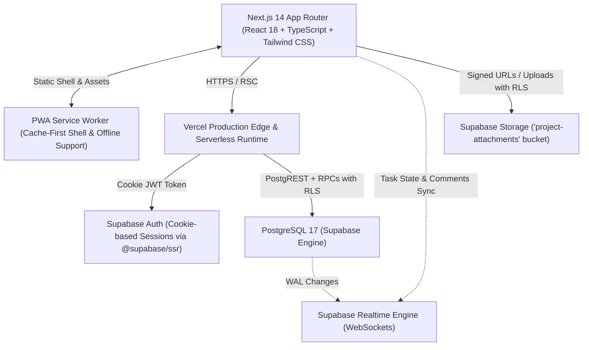
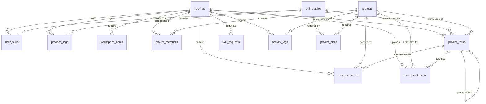

# Workbench: Project Architecture & System Specification

> **Version:** 1.9.0 Production  
> **Target Audience:** Engineering Assistants, AI Pair-Programmers, Technical Collaborators  
> **Live Production URL:** [https://workbench-project-journal.vercel.app](https://workbench-project-journal.vercel.app)  
> **Source Repository:** [GitHub - Cviznak/workbench-project-journal](https://github.com/Cviznak/workbench-project-journal) (Branch: `clean`)  

---

## 1. Executive Summary & Purpose

**Workbench** is a production-grade, globally secure, full-stack Gamified Project Management, Maker Inventory, and Deliberate Practice platform. Built for creators, engineers, and multidisciplinary makers, Workbench bridges the gap between private brainstorming, structured collaborative project execution, and skill progression.

Unlike standard task boards, Workbench treats productivity through an RPG progression lens:
- Completing tasks and logging deliberate practice awards auditable Experience Points (XP).
- XP advances maker skills through deterministic mathematical leveling.
- Deliberate practice is backed by procedural Web Audio focus soundscapes and a built-in Pomodoro timer.
- Brainstorming notes seamlessly graduate from raw ideas into structured projects.
- **Collaborative Task Workshop**: Tasks feature live-updating Markdown discussion threads, private multi-file attachments (up to 5MB, served via secure temporary signed URLs), and **Task Dependencies** (`prerequisite_task_id` with execution locks).
- **Task Bill of Materials (BOM) & Auto-Stock Deduction** *(v1.5)*: Projects track exact consumable usage and unit economics. Upon task completion, material stock is automatically deducted from `inventory_items`, with low-stock alerts auto-filling the restock cart.
- **Finished Creations Gallery, Unit Economics & Margin Simulator** *(v1.6)*: Workshop formulas link directly to `'FINISHED_GOOD'` items. Executing a batch automatically deducts raw materials, calculates all-in unit Cost of Goods Sold (COGS = ingredients + packaging overhead), increments finished product inventory stock, touches consistency streaks, and awards `+15 XP`. The Formula Editor features a live Unit Economics & Margin Simulator with gross profit margins and optional 9.5% marketplace fee deductions (e.g. Etsy/Stripe).
- **Interactive Maker Calculators & Lab Tools** *(v1.7)*: Dedicated lab suite with 3 specialized calculators: Epoxy Resin & Mold Volume (with exothermic thermal runaway warnings for pours >100g, micro-batch scale notices, and part A/B weight breakdown), Perfume Dilution & Concentration (Extrait, EDP, EDT, EDC with fragrance oil & ethanol density weighting and maceration guidance), and 3D Print Costing (filament material, purge allowance, machine electricity consumption, and target gross margin slider). All 3 feature 1-click "Save as New Formula" export.
- **Recipe Batch Run Logs & Quality History** *(v1.7)*: Executes batches with customizable multipliers, star ratings (1–5), and batch notes (ambient temperature, curing time, scent maturation). Cards feature an expandable "Past Batch Runs" timeline.
- **Workspace Blueprint Swatches & Interactive Checklists** *(v1.7)*: Workspace ideas feature persistent JSONB metadata (`metadata_json`) with click-to-copy hex color swatches and interactive checklist items with live progress percentage counters.
- **Maker Consistency Engine**: Tracks daily maker streaks (`current_streak`, `longest_streak`) and visualizes consistency with a responsive 52-week (365-day) contribution heatmap.
- **Maker Inventory, Formulas & Recipes** *(v1.4, v1.5 & v1.6)*: Realtime inventory management for materials, equipment, and finished goods with custom folder categorization, stock steppers, automated low-stock warnings, 1-click AliExpress / Temu restock links, repeatable maker recipes (with batch multipliers and 1-click stock deduction), and bulk preset quick-adding.
- **Teammate @Username Discovery & Project Roster Management** *(v1.8)*: Live debounced teammate search (`search_makers_for_invite`) with instant invite (`invite_user_to_project`) and leave/revoke/remove controls (`remove_project_member`) in a unified, tabbed `EditProjectModal`. Incomplete assigned tasks are cleanly unassigned on member departure.
- **1-Click Project Starter Blueprints** *(v1.8)*: Choose from Blank Project or 4 pre-built maker workflows (Resin & Mold Casting, Perfume Accord Lab, 3D Print Prototype, Illustration Tabletop Pack) that auto-seed initial tasks, descriptions, priorities, and subtask checklists upon creation.
- **Mobile PWA Native Bottom Navigation** *(v1.8)*: Responsive fixed bottom bar on mobile (< lg breakpoint) providing 1-tap navigation across Dashboard, Community, Projects, Skills, and Inventory, with safe-area bottom clearance (`pb-24 lg:pb-8`).
- **Universal Searchable Skill Picker** *(v1.9)*: Combobox (`SkillSelector.tsx`) with single and multi-selection, live query filtering across 40+ maker skills, category pills, and practiced skill indicators integrated across Practice Logger, Project Creator, Edit Project, and Task Edit modals.
- **Maker Community Social Feed** *(v1.9)*: Public social hub (`/community`) powered by `public.community_posts`, `public.post_likes`, `public.post_comments`, and storage bucket `'community-media'`. Features Markdown post composer, media uploads up to 5MB, skill tagging, linked projects with auto-showcase opt-in, optimistic likes (`toggle_post_like` RPC), and nested comments.
- **Public Maker Profiles** *(v1.9)*: Discoverable profiles (`/makers/[username]`) showcasing a maker's biography (`profiles.bio`), total XP, maker level, consistency streaks, authored community posts, leveled skill mastery bars, and showcase projects. Includes an inline bio editor and one-click profile link sharing.
- **Public Project Showcase Mode** *(v1.9)*: Opt-in public visibility (`is_public = true` on `public.projects`). Non-members can view project milestones, task progress bars, and read-only Kanban board blueprints. Also displays a dedicated "Project Updates & Community Activity" feed stream.
- **Portable Data Sovereignty & Relational Restore** *(v1.7)*: One-click **"Export Complete Maker Archive"** exports complete user records into a standardized portable JSON archive (v1.7.0). **"Verify & Restore Maker Archive"** enables seamless relational data recovery with JSON schema validation, itemized count preview modal, and conflict-free foreign key re-mapping.
- **Progressive Web App (PWA)**: Full standalone installability with Service Worker shell caching for offline navigation.

Security and relational integrity are paramount: the platform operates on a **Zero-Client-Trust architecture**. No browser can spoof XP, levels, or administrative privileges; all state transitions and balance mutations occur inside PostgreSQL `SECURITY DEFINER` functions guarded by Row Level Security (RLS).

---

## 2. Technology Stack & Deployment Architecture



### Core Technologies
| Layer | Technology | Details |
|---|---|---|
| **Frontend Framework** | **Next.js 14.2 (App Router)** | Server Components (RSC), Client Components, Server Actions |
| **Language & Typings** | **TypeScript 5 (Strict Mode)** | 100% strict type safety across database types, models, and UI props |
| **Styling & Design** | **Tailwind CSS + Tailwind Animate** | Responsive layout (`overflow-x: clip`), CSS View transitions, Dark mode |
| **PWA & Offline** | **Web App Manifest + Service Worker** | Standalone installable PWA, offline app shell precaching (`/sw.js`) |
| **Icons & Media** | **Lucide React** | Feather-style vector iconography |
| **Audio Synthesizer** | **Web Audio API (Procedural)** | Zero external assets: synthesized chimes, fanfare, binaural beats, brown/pink noise, procedural Rhodes |
| **Celebrations** | **canvas-confetti** | Hardware-accelerated canvas particles for level-ups and task completion |
| **Backend & Database** | **Supabase (PostgreSQL 17)** | Row Level Security (RLS), Triggers, Stored Procedures (`SECURITY DEFINER`) |
| **Storage** | **Supabase Storage** | Private bucket `'project-attachments'` with folder RLS and temporary signed URLs |
| **Authentication** | **Supabase Auth + `@supabase/ssr`** | HttpOnly cookie-based session management across SSR, Route Handlers, and Middleware |
| **Hosting & CDN** | **Vercel** | Automated CI/CD, production edge routing, global CDN caching |

---

## 3. Database Schema & Relational Architecture

All tables reside in the `public` schema and enforce **Row Level Security (RLS)**.



### Table Definitions & Specifications

#### 1. `public.profiles`
Represents user profiles synchronized from `auth.users`.
- `id` (`UUID`, PK, references `auth.users.id` ON DELETE CASCADE)
- `username` (`TEXT`, UNIQUE, alphanumeric)
- `display_name` (`TEXT`)
- `avatar_url` (`TEXT`, nullable)
- `role` (`TEXT`, DEFAULT `'USER'` CHECK `role IN ('ROOT_ADMIN', 'ADMIN', 'USER')`)
- `is_immutable` (`BOOLEAN`, DEFAULT `false`) — Identifies the Genesis Root Admin
- `is_suspended` (`BOOLEAN`, DEFAULT `false`) — Administrative killswitch
- `current_streak` (`INT`, DEFAULT `0`) — Active daily practice/build streak
- `longest_streak` (`INT`, DEFAULT `0`) — Historical personal best streak
- `last_active_date` (`DATE`, nullable) — Last calendar day activity was recorded
- `settings_json` (`JSONB`, DEFAULT `'{}'::jsonb`)
- `created_at` (`TIMESTAMPTZ`, DEFAULT `now()`)

#### 2. `public.skill_catalog`
Global standardized skill repository.
- `id` (`UUID`, PK, DEFAULT `gen_random_uuid()`)
- `slug` (`TEXT`, UNIQUE, lowercase trimmed slug e.g. `'threejs'`, `'carpentry'`)
- `name` (`TEXT`, e.g. `'Three.js 3D Graphics'`)
- `category` (`TEXT`, e.g. `'Software Development'`, `'Crafting & Making'`)
- `created_at` (`TIMESTAMPTZ`, DEFAULT `now()`)

#### 3. `public.user_skills`
User skill mastery and XP ledger.
- `id` (`UUID`, PK, DEFAULT `gen_random_uuid()`)
- `user_id` (`UUID`, references `profiles.id` ON DELETE CASCADE)
- `skill_id` (`UUID`, references `skill_catalog.id` ON DELETE CASCADE)
- `total_xp` (`INT`, DEFAULT `0` CHECK `total_xp >= 0`)
- `level` (`INT`, DEFAULT `1` CHECK `level >= 1`)
- `last_practiced_at` (`TIMESTAMPTZ`, nullable)
- `created_at` (`TIMESTAMPTZ`, DEFAULT `now()`)
- **Unique Constraint:** `UNIQUE(user_id, skill_id)`
- **Formula:** `level = floor(0.1 * sqrt(total_xp)) + 1`

#### 4. `public.practice_logs`
Auditable record of deliberate practice sessions.
- `id` (`UUID`, PK, DEFAULT `gen_random_uuid()`)
- `user_id` (`UUID`, references `profiles.id` ON DELETE CASCADE)
- `skill_id` (`UUID`, references `skill_catalog.id` ON DELETE CASCADE)
- `duration_minutes` (`INT` CHECK `duration_minutes BETWEEN 1 AND 600`)
- `xp_gained` (`INT` CHECK `xp_gained >= 0`)
- `note` (`TEXT`)
- `created_at` (`TIMESTAMPTZ`, DEFAULT `now()`)

#### 5. `public.workspace_items`
Private maker notebook for raw ideas and markdown documents.
- `id` (`UUID`, PK, DEFAULT `gen_random_uuid()`)
- `user_id` (`UUID`, references `profiles.id` ON DELETE CASCADE)
- `item_type` (`TEXT` CHECK `item_type IN ('IDEA', 'NOTE')`)
- `title` (`TEXT`)
- `content_md` (`TEXT`, Markdown formatting)
- `tags` (`TEXT[]`, DEFAULT `'{}'::text[]`)
- `idea_status` (`TEXT`, DEFAULT `'RAW'` CHECK `idea_status IN ('RAW', 'PROTOTYPING', 'PROMOTED', 'SHELVED')`)
- `is_pinned` (`BOOLEAN`, DEFAULT `false`)
- `created_at` (`TIMESTAMPTZ`, DEFAULT `now()`)
- `updated_at` (`TIMESTAMPTZ`, DEFAULT `now()`)

#### 6. `public.projects`
Collaborative maker projects.
- `id` (`UUID`, PK, DEFAULT `gen_random_uuid()`)
- `name` (`TEXT`)
- `description` (`TEXT`)
- `pm_user_id` (`UUID`, references `profiles.id` ON DELETE RESTRICT) — Project Manager
- `status` (`TEXT`, DEFAULT `'PLANNING'` CHECK `status IN ('PLANNING', 'ACTIVE', 'COMPLETED', 'ARCHIVED')`)
- `completion_xp_reward` (`INT`, DEFAULT `100` CHECK `completion_xp_reward >= 0`)
- `xp_awarded` (`BOOLEAN`, DEFAULT `false`)
- `created_at` (`TIMESTAMPTZ`, DEFAULT `now()`)

#### 7. `public.project_members`
Project membership mapping with handshake status.
- `project_id` (`UUID`, references `projects.id` ON DELETE CASCADE)
- `user_id` (`UUID`, references `profiles.id` ON DELETE CASCADE)
- `invitation_status` (`TEXT`, DEFAULT `'PENDING'` CHECK `invitation_status IN ('PENDING', 'ACCEPTED')`)
- `joined_at` (`TIMESTAMPTZ`, DEFAULT `now()`)
- **Primary Key:** `(project_id, user_id)`
- Auto-enroll trigger `trg_project_pm_membership` ensures project creators are always enrolled with `'ACCEPTED'` status.

#### 8. `public.project_skills`
Skills relevant to a project.
- `project_id` (`UUID`, references `projects.id` ON DELETE CASCADE)
- `skill_id` (`UUID`, references `skill_catalog.id` ON DELETE CASCADE)
- **Primary Key:** `(project_id, skill_id)`

#### 9. `public.project_tasks`
Tasks with XP rewards, subtasks checklist, and prerequisite task dependencies.
- `id` (`UUID`, PK, DEFAULT `gen_random_uuid()`)
- `project_id` (`UUID`, references `projects.id` ON DELETE CASCADE)
- `assignee_id` (`UUID`, references `profiles.id` ON DELETE SET NULL, nullable)
- `skill_id` (`UUID`, references `skill_catalog.id` ON DELETE SET NULL, nullable)
- `prerequisite_task_id` (`UUID`, references `public.project_tasks(id)` ON DELETE SET NULL, nullable) *(v1.3)*
- `title` (`TEXT`)
- `description` (`TEXT`)
- `status` (`TEXT`, DEFAULT `'TODO'` CHECK `status IN ('TODO', 'IN_PROGRESS', 'REVIEW', 'DONE')`)
- `priority` (`TEXT`, DEFAULT `'MEDIUM'` CHECK `priority IN ('LOW', 'MEDIUM', 'HIGH', 'CRITICAL')`)
- `xp_reward` (`INT`, DEFAULT `25` CHECK `xp_reward >= 0`)
- `xp_awarded` (`BOOLEAN`, DEFAULT `false`)
- `order_index` (`INT`, DEFAULT `0`)
- `subtasks` (`JSONB`, DEFAULT `'[]'::jsonb`) — Array of `{ id: string, title: string, completed: boolean }`
- `created_at` (`TIMESTAMPTZ`, DEFAULT `now()`)
- `updated_at` (`TIMESTAMPTZ`, DEFAULT `now()`)

#### 10. `public.task_comments`
Realtime Markdown discussion threads scoped to individual project tasks.
- `id` (`UUID`, PK, DEFAULT `gen_random_uuid()`)
- `task_id` (`UUID`, references `project_tasks.id` ON DELETE CASCADE)
- `project_id` (`UUID`, references `projects.id` ON DELETE CASCADE)
- `user_id` (`UUID`, references `profiles.id` ON DELETE CASCADE)
- `content_md` (`TEXT`, CHECK `char_length(trim(content_md)) BETWEEN 1 AND 5000`)
- `is_edited` (`BOOLEAN`, DEFAULT `false`)
- `created_at` (`TIMESTAMPTZ`, DEFAULT `now()`)
- `updated_at` (`TIMESTAMPTZ`, DEFAULT `now()`)

#### 11. `public.task_attachments`
Private multi-file attachments metadata linked to Supabase Storage.
- `id` (`UUID`, PK, DEFAULT `gen_random_uuid()`)
- `task_id` (`UUID`, references `project_tasks.id` ON DELETE CASCADE)
- `project_id` (`UUID`, references `projects.id` ON DELETE CASCADE)
- `uploader_id` (`UUID`, references `profiles.id` ON DELETE CASCADE)
- `file_name` (`TEXT`, NOT NULL)
- `storage_path` (`TEXT`, NOT NULL, UNIQUE) — `{project_id}/{task_id}/{uuid}_{filename}`
- `mime_type` (`TEXT`, NOT NULL)
- `size_bytes` (`INT`, NOT NULL, CHECK `size_bytes > 0 AND size_bytes <= 5242880`) — Max 5MB
- `created_at` (`TIMESTAMPTZ`, DEFAULT `now()`)

#### 12. `public.inventory_folders` *(v1.4)*
Custom categorization folders for maker workshop materials and equipment.
- `id` (`UUID`, PK, DEFAULT `gen_random_uuid()`)
- `user_id` (`UUID`, references `profiles.id` ON DELETE CASCADE)
- `name` (`TEXT`, NOT NULL, CHECK `char_length(trim(name)) BETWEEN 1 AND 100`)
- `color` (`TEXT`, DEFAULT `'#6366f1'`)
- `icon` (`TEXT`, DEFAULT `'folder'`)
- `created_at` (`TIMESTAMPTZ`, DEFAULT `now()`)
- RLS: Strictly private to owner (`(SELECT auth.uid()) = user_id`).

#### 13. `public.inventory_items` *(v1.4)*
Consumables, raw materials, fasteners, and machinery items with restock tracking.
- `id` (`UUID`, PK, DEFAULT `gen_random_uuid()`)
- `user_id` (`UUID`, references `profiles.id` ON DELETE CASCADE)
- `folder_id` (`UUID`, references `inventory_folders.id` ON DELETE SET NULL, nullable)
- `item_type` (`TEXT`, DEFAULT `'MATERIAL'` CHECK `item_type IN ('MATERIAL', 'EQUIPMENT')`)
- `name` (`TEXT`, NOT NULL, CHECK `char_length(trim(name)) BETWEEN 1 AND 150`)
- `description` (`TEXT`, DEFAULT `''`)
- `sku_or_location` (`TEXT`, DEFAULT `''`) — Storage location or bin (e.g. "Bin A3", "Drawer 2")
- `quantity` (`NUMERIC(10, 2)`, DEFAULT `0` CHECK `quantity >= 0`)
- `unit` (`TEXT`, DEFAULT `'pcs'`) — e.g. `'pcs'`, `'g'`, `'kg'`, `'ml'`, `'l'`, `'cm'`, `'m'`, `'rolls'`
- `low_stock_threshold` (`NUMERIC(10, 2)`, DEFAULT `0` CHECK `low_stock_threshold >= 0`)
- `unit_price` (`NUMERIC(10, 2)`, DEFAULT `0` CHECK `unit_price >= 0`)
- `currency` (`TEXT`, DEFAULT `'ILS'` CHECK `currency IN ('ILS', 'USD', 'EUR')`)
- `condition` (`TEXT`, DEFAULT `'GOOD'` CHECK `condition IN ('GOOD', 'NEEDS_MAINTENANCE', 'REPLACE')`)
- `search_keyword` (`TEXT`, DEFAULT `''`) — Custom phrase for AliExpress / Temu link generator
- `reorder_url` (`TEXT`, DEFAULT `''`) — Direct link to past supplier product listing
- `in_restock_cart` (`BOOLEAN`, DEFAULT `false`)
- `restock_target_qty` (`NUMERIC(10, 2)`, DEFAULT `1` CHECK `restock_target_qty > 0`)
- `updated_at` (`TIMESTAMPTZ`, DEFAULT `now()`)
- `created_at` (`TIMESTAMPTZ`, DEFAULT `now()`)
- RLS: Strictly private to owner (`(SELECT auth.uid()) = user_id`).

#### 14. `public.task_materials` *(v1.5)*
Links project tasks to inventory items for bill-of-materials costing and automated stock deduction.
- `id` (`UUID`, PK, DEFAULT `gen_random_uuid()`)
- `task_id` (`UUID`, references `project_tasks.id` ON DELETE CASCADE)
- `project_id` (`UUID`, references `projects.id` ON DELETE CASCADE)
- `inventory_item_id` (`UUID`, references `inventory_items.id` ON DELETE CASCADE)
- `quantity_required` (`NUMERIC(10, 2)`, CHECK `quantity_required > 0`)
- `deducted` (`BOOLEAN`, DEFAULT `false`)
- `created_at` (`TIMESTAMPTZ`, DEFAULT `now()`)
- UNIQUE(`task_id`, `inventory_item_id`)
- RLS: Accessible to project members via `public.is_project_member(project_id)`.

#### 15. `public.maker_recipes` *(v1.5)*
Repeatable workshop formulas (resin ratios, filament parameters, perfume accords).
- `id` (`UUID`, PK, DEFAULT `gen_random_uuid()`)
- `user_id` (`UUID`, references `profiles.id` ON DELETE CASCADE)
- `title` (`TEXT`, NOT NULL)
- `category` (`TEXT`, DEFAULT `'General'`)
- `instructions_md` (`TEXT`, DEFAULT `''`)
- `rating` (`INT`, CHECK `rating BETWEEN 1 AND 5`, nullable)
- `created_at` (`TIMESTAMPTZ`, DEFAULT `now()`)
- `updated_at` (`TIMESTAMPTZ`, DEFAULT `now()`)
- RLS: Strictly private to owner (`(SELECT auth.uid()) = user_id`).

#### 16. `public.recipe_ingredients` *(v1.5)*
Specific inventory ingredients and amounts linked to a recipe.
- `id` (`UUID`, PK, DEFAULT `gen_random_uuid()`)
- `recipe_id` (`UUID`, references `maker_recipes.id` ON DELETE CASCADE)
- `inventory_item_id` (`UUID`, references `inventory_items.id` ON DELETE CASCADE)
- `quantity_required` (`NUMERIC(10, 2)`, CHECK `quantity_required > 0`)
- UNIQUE(`recipe_id`, `inventory_item_id`)
- RLS: Checked via parent recipe ownership.

#### 17. `public.activity_logs`
Immutable system audit ledger.
- `id` (`UUID`, PK, DEFAULT `gen_random_uuid()`)
- `user_id` (`UUID`, references `profiles.id` ON DELETE CASCADE)
- `project_id` (`UUID`, references `projects.id` ON DELETE SET NULL, nullable)
- `event_type` (`TEXT`)
- `summary` (`TEXT`)
- `xp_delta` (`INT`, DEFAULT `0`)
- `metadata` (`JSONB`, DEFAULT `'{}'::jsonb`)
- `created_at` (`TIMESTAMPTZ`, DEFAULT `now()`)

---

## 4. PostgreSQL `SECURITY DEFINER` RPCs

| RPC Function | Parameters | Permissions & Security Behavior |
|---|---|---|
| `complete_project_task` *(v1.5)* | `p_task_id UUID` | Enforces prerequisite task dependency check (`v_task.prerequisite_task_id` must be `'DONE'`). Moves status to `'DONE'`, auto-deducts attached task materials from `inventory_items` (flagging low stock to restock cart), marks `xp_awarded = true`, touches assignee streak (`touch_user_streak`), grants `xp_reward` to assignee, and logs XP event. Guarded by `guard_task_xp_tamper` trigger against client bypass. |
| `complete_project` | `p_project_id UUID` | Callable only by `projects.pm_user_id`. Sets `status = 'COMPLETED'` and `xp_awarded = true`. Awards `completion_xp_reward` to all members with `invitation_status = 'ACCEPTED'` across all linked project skills, touching their streaks. |
| `execute_maker_recipe` *(v1.6)* | `p_recipe_id UUID, p_batch_multiplier NUMERIC` | Validates `auth.uid()`. Deducts `quantity_required * multiplier` from all recipe ingredients in `inventory_items`, auto-triggers restock cart for low stock. Computes unit COGS (`[ingredients batch cost / output_yield_qty] + packaging_overhead`). If recipe has `output_item_id`, increments stock by `output_yield_qty * multiplier` and sets unit cost. Grants `+15 XP` (advancing `general-crafting`), touches daily streak, and records `'RECIPE_EXECUTED'` in audit activity ledger. |
| `export_user_maker_archive` *(v1.6)* | None | Validates `auth.uid()`. Compiles and returns a complete, structured JSON document (version `'1.6.0'`) containing the user's profile, user skills, deliberate practice logs, workspace items, projects, assigned tasks, comments, inventory folders, inventory items, task materials, recipes, recipe ingredients, and activity audit ledger. |
| `touch_user_streak` | `p_user_id UUID` | Inspects `last_active_date`. If today, returns. If yesterday, increments `current_streak` and updates `longest_streak`. Otherwise resets `current_streak = 1`. Sets `last_active_date = CURRENT_DATE`. |
| `get_user_activity_heatmap` | `p_days INT DEFAULT 365` | Returns 365-day series for `auth.uid()` with daily `practice_minutes`, `tasks_completed`, `xp_earned`, and `intensity` (0..4). |
| `log_skill_practice` | `p_skill_name TEXT, p_duration_minutes INT, p_xp INT, p_note TEXT, p_skill_id UUID` | Requires skill to exist in `skill_catalog`. Validates `duration BETWEEN 1 AND 600`. Computes deterministic XP (`duration * 2`) inside PostgreSQL, touches daily streak, recalculates level, and records practice log. |
| `accept_project_invite` | `p_project_id UUID` | Validates `auth.uid()`. Transitions member `invitation_status` from `'PENDING'` to `'ACCEPTED'`. |
| `decline_project_invite` | `p_project_id UUID` | Validates `auth.uid()`. Deletes member row where `invitation_status = 'PENDING'`. |

---

## 5. Application Architecture & File Map

```
c:\Users\rakow\Documents\VibeLearning\Projects\
├── public/
│   ├── manifest.json              # Standalone installable PWA manifest with shortcuts (v1.3)
│   ├── sw.js                      # Cache-First static shell & offline navigation service worker (v1.3)
│   ├── favicon.svg
│   └── favicon.ico
├── src/
│   ├── app/
│   │   ├── (auth)/                # Public authentication routes
│   │   │   ├── login/page.tsx     # Sign in with email + password
│   │   │   ├── signup/page.tsx    # Sign up with existing-account redirect helper
│   │   │   └── suspended/page.tsx # Account suspension landing page
│   │   ├── (dashboard)/           # Authenticated application shell
│   │   │   ├── loading.tsx        # Instant navigation skeleton placeholder (v1.7.1)
│   │   │   ├── layout.tsx         # Dashboard layout, SSR session & XP calculation
│   │   │   ├── page.tsx           # Home Dashboard: XP progress, Heatmap, active tasks, activity
│   │   │   ├── community/page.tsx # Maker Community Social Feed (v1.9)
│   │   │   ├── makers/
│   │   │   │   └── [username]/page.tsx # Public Maker Profile & Project Showcase (v1.9)
│   │   │   ├── skills/page.tsx    # Skills Hub: Catalog, requests, practice ledger
│   │   │   ├── workspace/page.tsx # Ideas & Notes: Split-pane markdown workspace
│   │   │   ├── projects/
│   │   │   │   ├── page.tsx       # Projects list and Create Project modal
│   │   │   │   └── [id]/page.tsx  # Interactive Kanban board & PM controls (Public Showcase mode v1.9)
│   │   │   ├── inventory/page.tsx # Maker Inventory & Smart Restock Cart (v1.4)
│   │   │   ├── admin/page.tsx     # Security & Admin Hub (role-gated)
│   │   │   └── settings/page.tsx  # Profile settings, password change, Data & Backup export (v1.3)
│   │   ├── auth/callback/route.ts # Supabase Auth code exchange handler
│   │   ├── globals.css            # Tailwind base, dark palette, overflow-x: clip
│   │   └── layout.tsx             # Root layout, manifest metadata, ServiceWorkerRegister
│   ├── components/
│   │   ├── ActivityHeatmap.tsx    # Responsive 52-week contribution heatmap & streak cards
│   │   ├── AdminHubClient.tsx     # User directory, Skill Request approvals, Audit logs
│   │   ├── CommunityFeedClient.tsx # Social feed: posts, photos, likes, comments (v1.9)
│   │   ├── EditProjectModal.tsx   # Project settings, skills & Public Showcase toggle (v1.9)
│   │   ├── EditTaskModal.tsx      # Workshop modal: Details, Prerequisite dependency, Comments, Files
│   │   ├── FocusAudioBar.tsx      # Pomodoro timer + procedural ambient noise / lofi
│   │   ├── InventoryClient.tsx    # Maker Inventory Hub: Folders, steppers, low stock, AliExpress/Temu (v1.4)
│   │   ├── KanbanBoardClient.tsx  # Drag-and-drop board with Realtime sync, subtasks & task lock badges
│   │   ├── MakerProfileClient.tsx # Public maker profiles, bio editor & public showcase projects (v1.9)
│   │   ├── Navbar.tsx             # Sticky header, search, audio bar, streak & level pills, bell
│   │   ├── NotificationBell.tsx   # Project invitation handshake & skill requests inbox
│   │   ├── PracticeModal.tsx      # Deliberate practice logging modal with SkillSelector (v1.9)
│   │   ├── ServiceWorkerRegister.tsx # Client service worker registration for PWA (v1.3)
│   │   ├── SettingsClient.tsx     # Account settings & Portable Archive JSON exporter (v1.3)
│   │   ├── Sidebar.tsx            # Full-height pinned navigation sidebar
│   │   ├── SkillRequestModal.tsx  # Maker proposal modal for new skills
│   │   ├── SkillSelector.tsx      # Universal searchable skill combobox (single/multi) (v1.9)
│   │   ├── SkillsViewClient.tsx   # Skills grid, tier badges, practice history ledger
│   │   ├── SpotlightSearch.tsx    # Global Ctrl+K / Cmd+K command palette
│   │   ├── TaskCompleteButton.tsx # One-click task resolution with XP animation
│   │   └── ThemeToggle.tsx        # Dark / Light mode toggle
│   ├── lib/
│   │   ├── soundEffects.ts        # Web Audio procedural synthesizer & confetti triggers
│   │   ├── supabase/
│   │   │   ├── client.ts          # Client-side Supabase browser client
│   │   │   ├── server.ts          # SSR server-side Supabase client
│   │   │   └── middleware.ts      # Auth token refresh & route protection
│   │   ├── types.ts               # Core TypeScript models, interfaces, & formulas
│   │   └── utils.ts               # Styling cn(), level progress math, date formatting
│   └── middleware.ts              # Next.js global route middleware
├── supabase/
│   └── migrations/
│       ├── 001_init_schema_and_rls.sql             # Schema, RLS, Genesis trigger, Base RPCs
│       ├── 002_subtasks_and_realtime.sql           # Subtasks JSONB & Realtime publication
│       ├── 003_skill_requests.sql                  # Skill requests table, RLS, & approval RPCs
│       ├── 004_hardening_and_invites.sql           # v1.1 hardening: close XP bypass & invite handshake
│       ├── 005_task_collaboration_and_streaks.sql  # v1.2: Comments, attachments, streaks, heatmap
│       ├── 006_fix_pm_membership.sql               # v1.2.1 fix: Auto-enroll PMs as ACCEPTED members
│       ├── 007_fix_task_update_rls.sql             # v1.2.2 fix: Remove recursive subquery from task update RLS & guard xp_awarded
│       ├── 008_task_dependencies_and_pwa.sql      # v1.3: Task dependencies & maker archive export
│       ├── 009_inventory_and_restock_cart.sql      # v1.4: Maker inventory, folders & restock cart
│       ├── 010_task_materials_and_recipes.sql     # v1.5: Task BOM, maker recipes & auto-deduct stock
│       ├── 011_finished_goods_and_pricing.sql     # v1.6: Finished creations gallery, unit economics & margin simulator
│       ├── 012_calculators_and_batch_logs.sql     # v1.7: Interactive maker calculators, recipe batch run logs & workspace blueprints
│       ├── 013_fix_privacy_modal_and_latency.sql  # v1.7.1: Project privacy lockdown, create_maker_project RPC & latency optimization
│       ├── 014_teammate_search_and_templates.sql  # v1.8.0: Teammate search RPC, safe invite/remove RPCs, starter blueprints & mobile PWA bottom nav
│       └── 015_social_feed_profiles_and_skill_search.sql # v1.9.0: Community posts, likes, comments, public profiles & searchable skill selector
├── package.json
└── tailwind.config.ts
```

---

## 6. Operational Rules for Pair-Programmers & Assistants

1. **Never use CR (Carriage Return) line endings**: All files must strictly maintain **100% pure LF line endings**.
2. **Never mention the "J-word" anywhere in the app or copy**: The platform is branded exclusively as **Workbench**.
3. **Never bypass RLS**: All XP awards, streak touches, and role escalations must go through `SECURITY DEFINER` RPC functions with server-side validation of `auth.uid()`.
4. **Preserve sticky headers**: Do not place `overflow-x: hidden` on parent containers of sticky elements; use `overflow-x: clip;` in `globals.css` instead.
