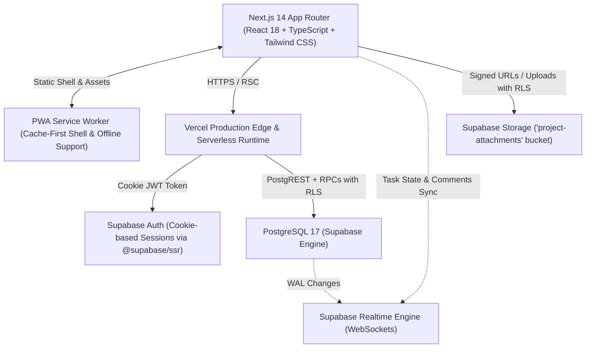
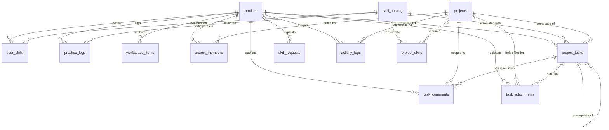

# Workbench: Project Architecture & System Specification

> **Version:** 3.3.0 Production<br />
> **Target Audience:** Engineering Assistants, AI Pair-Programmers, Technical Collaborators  
> **Live Production URL:** [https://www.workbenchsoc.com](https://www.workbenchsoc.com) | [https://workbenchsoc.com](https://workbenchsoc.com)  
> **Source Repository:** [GitHub - Cviznak/workbench-project-journal](https://github.com/Cviznak/workbench-project-journal) (Branch: `clean`)  

---

## 1. Executive Summary & Purpose

**Workbench** is a production-grade, globally secure, full-stack Gamified Project Management, Maker Inventory, and Deliberate Practice platform. Built for creators, engineers, and multidisciplinary makers, Workbench bridges the gap between private brainstorming, structured collaborative project execution, and skill progression.

Unlike standard task boards, Workbench treats productivity through an RPG progression lens:
- Completing tasks and logging deliberate practice awards auditable Experience Points (XP).
- XP advances maker skills through deterministic mathematical leveling.
- Deliberate practice is backed by procedural Web Audio focus soundscapes and a built-in Pomodoro timer.
- Brainstorming notes seamlessly graduate from raw ideas into structured projects.
- **Financial Ledger & Effort Rollup Dark-First Contrast Remediation** *(v3.3)*: Resolved the unreadable white-on-white contrast issue (`image_cca5d9.png`) in `KanbanBoardClient.tsx`. Replaced washed-out cards with dark-first adaptive containers (`bg-white dark:bg-slate-900/90 border border-slate-200/80 dark:border-slate-800/80 rounded-2xl p-5 shadow-sm space-y-2.5`), high-contrast primary metrics (`text-2xl font-bold text-slate-900 dark:text-white tracking-tight`), bold uppercase headers (`text-xs font-semibold uppercase tracking-wider text-slate-500 dark:text-slate-400`), adaptive secondary text (`text-xs font-medium text-slate-600 dark:text-slate-300`), and dark-mode progress tracks (`w-full bg-slate-200 dark:bg-slate-800 h-2 rounded-full overflow-hidden`).
- **Live Task Stopwatch & Deliberate Practice Session Logger** *(v3.3)*: Database migration `029_v33_task_timer_and_stock_ledger.sql` adds `actual_minutes INT NOT NULL DEFAULT 0 CHECK (actual_minutes >= 0 AND actual_minutes <= 60000)` to `public.project_tasks` and creates `public.log_task_work_session(p_task_id UUID, p_duration_minutes INT, p_note TEXT)` `SECURITY DEFINER` RPC. Makers can run a live task stopwatch with a sticky header bar (displaying live MM:SS, pause/resume, and "Stop & Log Session (+XP)") or manually log work sessions. Automatically credits `duration * 2` deliberate practice XP to linked skills or touches streaks, updates `status = 'TODO'` to `'IN_PROGRESS'`, logs project activity, and rolls up actual vs estimated effort. `EditTaskModal.tsx` integrates native actual logged time badges and inline session logging.
- **Inventory Stock Movement History Ledger (`public.inventory_transactions`)** *(v3.3)*: Introduces immutable stock movement history tracking in `public.inventory_transactions` with owner-isolated RLS (`auth.uid() = user_id`) and automated trigger `trg_log_inventory_quantity_change` on `public.inventory_items`. Automatically records stock additions, restock cart receptions (`RESTOCK_CART`), task BOM deductions (`TASK_BOM`), recipe batch runs (`RECIPE_BATCH`), CSV bulk imports (`CSV_IMPORT`), and manual adjustments (`MANUAL`). Item cards in `InventoryClient.tsx` feature a dedicated History button opening a high-density audit trail with timestamps, signed delta badges, balance after, and reference notes.
- **Woodworking Linear & Sheet Cut-List Kerf Optimizer & Board-Foot Calculator** *(v3.3)*: Expanded the public `/tools` suite and in-app workshop calculators with a 9th high-traffic interactive tool (`/tools?tool=woodworking`). Dual-unit metric (mm) and imperial (inches) engine with First-Fit Decreasing (FFD) 1D greedy bin-packing optimization. Factors stock lumber dimensions (L x W x T), saw blade kerf loss (default 3.2mm / 0.125"), board price, and dynamic cut lists to compute total stock boards required, volumetric Board-Feet (`(T_in * W_in * L_in) / 144`), total lumber cost, cost per finished piece, material waste %, and interactive visual board cutting diagrams with 1-click "Save as Maker Formula" export. Supported across English, Russian, and Hebrew.
- **Calculator Header Layout Refactor & Overflow Remediation** *(v3.2)*: Resolved the cramped flex layout in `InventoryClient.tsx` by transitioning to a stacked responsive column architecture with wrapped calculator selection pills (`flex flex-wrap items-center gap-2`), eliminating clipped text and horizontal scrollbars across all screen widths.
- **Community Hub Marketplace Tabs: Public Formulas & Project Showcases** *(v3.2)*: Expanded `/community` with top-level discovery tabs (`communityView: 'FEED' | 'FORMULAS' | 'SHOWCASES'`) in `CommunityFeedClient.tsx` powered by `get_public_marketplace_feed(p_limit INT)` `SECURITY DEFINER STABLE` RPC. Public Formulas Lab provides search, craft category filtering, rating stars, author avatars, and 1-click "Clone to Workshop" (+50 XP to author). Project Showcases tab enables discovery of public blueprints with live milestone completion bars, linked skills, and budget indicators.
- **Project Financial & BOM Cost Rollup Ledger** *(v3.2)*: Database migration `028_v32_project_budgets_and_marketplace.sql` adds `budget_limit NUMERIC(10, 2) NOT NULL DEFAULT 0` and `currency TEXT NOT NULL DEFAULT 'USD'` to `public.projects`. `KanbanBoardClient.tsx` features a real-time Financial Ledger & Effort Rollup strip calculating all-in BOM consumable costs across tasks (via `convertCurrency` and `formatCurrency`), dynamic budget utilization bar (turning amber at 80% and red if over budget), and estimated labor hours (completed vs. remaining). Fully configurable in Create Project and Edit Project modals.
- **Silicone Mold Box Volume & Master Displacement Calculator** *(v3.2)*: Expanded the public `/tools` lab suite and in-app workshop calculators with an 8th interactive tool (`/tools?tool=silicone`). Factors mold box geometry (rectangular L x W x H or cylindrical Ø x H), master model Archimedes displacement (by weight + material density presets or direct volume), RTV silicone specific gravity (default 1.10), mix ratios (1:1 or 10:1), +10% safety pour margin, Part A & Part B pour weights, and material costing with 1-click "Save as Maker Formula" export. Supported across English, Russian, and Hebrew.
- **Interactive Project Dependency Graph & Roadmap View** *(v3.1)*: Database migration `027_v31_roadmap_equipment_logs_and_csv.sql` adds `due_date DATE` and `estimated_minutes INT` to `public.project_tasks`. `KanbanBoardClient.tsx` features an interactive View Switcher (`KANBAN` vs `ROADMAP`) organizing tasks into sequential roadmap stages with topological dependency resolution (Level 0 Foundations -> Level 1 -> Level 2 -> Level 3+), visual blocked/unlocked indicators, overdue detection, effort estimations, assignees, and 1-click status advance actions. `EditTaskModal.tsx` integrates native due date and effort duration inputs.
- **Universal CSV Importer & Exporter for Inventory & Restock Carts** *(v3.1)*: Universal CSV operations in `InventoryClient.tsx`. Export generates standard UTF-8 BOM CSVs (`workbench_inventory_YYYY-MM-DD.csv`) for entire workshops or filtered restock carts. Universal Import modal (`CsvImportModal`) supports drag-and-drop CSV upload, header auto-mapping (Name, Type, Quantity, Unit, Unit Price, SKU/Location, Threshold, Notes, Interval), client-side error validation and row previews, and calls `bulk_import_inventory_csv` `SECURITY DEFINER` RPC to batch insert/update inventory items.
- **Workshop Equipment Maintenance & Calibration Logbook** *(v3.1)*: Database migration `027_v31_roadmap_equipment_logs_and_csv.sql` adds `last_maintained_at TIMESTAMPTZ` and `maintenance_interval_days INT` to `public.inventory_items` and creates `public.equipment_logs` table. Equipment item cards show real-time overdue / due soon status badges and an interactive Logbook modal (`EquipmentLogModal`) to record maintenance, calibration, repairs, or inspections (`log_equipment_maintenance` RPC) with cost tracking and +10 XP awards.
- **Electronics & LED Resistor, Ohm's Law & Battery Runtime Estimator** *(v3.1)*: Expanded the public `/tools` lab suite and in-app workshop calculators with a 7th interactive tool (`/tools?tool=electronics`). Dual-mode calculator computing exact series LED current-limiting resistors, nearest standard E12 decade resistors, power dissipation, recommended wattage, and an interactive 4-band axial resistor SVG graphic with color codes and &plusmn;5% gold tolerance band. Battery mode calculates continuous runtime (hours & days), nominal Wh energy capacity, and load power draw with adjustable converter efficiency factors.
- **Portable Maker Archive Upgrade to v3.1.0** *(v3.1)*: Upgraded `public.export_user_maker_archive()` to package equipment maintenance history alongside achievements, recipes, runs, community posts, feedback, and inventory items for complete data sovereignty.
- **RPG Achievements, Maker Trophy Case & Custom Honor Engine** *(v3.0)*: Database migration `026_v3_achievements_telemetry_and_public_recipes.sql` introduces `public.achievements` and `public.user_achievements` tables seeded with 10 foundational RPG trophies spanning Bronze, Silver, Gold, Diamond, and Special tiers (e.g. *First Spark*, *Polymath*, *Night Owl*, *Century Club*, *Master Crafter*, *Open Source Maker*, *Grandmaster Maker*, *Workbench Pioneer*). Automated `evaluate_user_achievements()` `SECURITY DEFINER` RPC dynamically queries the caller's verified milestones (practice hours, completed tasks, streaks, catalog skills, formulas, public projects, and community engagement) and unlocks trophies with XP bonuses, in-app notifications (`ACHIEVEMENT_UNLOCKED`), and activity logs. Dedicated `TrophyCase.tsx` component showcases unlocked and locked trophies with tier styling and progress bars across the Dashboard and Public Maker Profiles (`/makers/[username]`). Administrative RPC `admin_grant_achievement_or_xp` allows admins to grant custom badges (e.g. Pioneer, Founder-Verified) and bonus XP (up to 2,500 XP) credited to specific skills with deterministic level recalculation (`floor(0.1 * sqrt(total_xp)) + 1`).
- **Admin Executive Telemetry & Platform Health KPI Dashboard** *(v3.0)*: Administrative `SECURITY DEFINER` RPC `get_admin_platform_telemetry()` returns real-time database KPIs across total makers, 7-day active makers, cumulative XP economy, practice hours, catalog skills, projects, public showcase projects, completed tasks, inventory items, batch recipes, public formulas, executed batch runs, community posts, comments, open feedback tickets, and pending skill requests. Renders a high-density Executive Telemetry Bento Grid at the top of `AdminHubClient.tsx` alongside user directory actions to "Grant Honor / Bonus XP".
- **Public Maker Formulas & 1-Click "Clone Recipe to My Workshop" Sharing Engine** *(v3.0)*: Migration 026 adds `is_public BOOLEAN` and `clones_count INT` to `public.maker_recipes` with updated SELECT RLS policies permitting public discovery of shared formulas. Administrative RPC `clone_public_recipe(p_source_recipe_id)` allows any maker to clone a public recipe and its exact ingredient bill-of-materials into their personal workshop (`is_public = false`, `clones_count = 0`), atomically incrementing source clones, awarding +50 XP to the original creator, and dispatching an in-app notification (`RECIPE_CLONED`). Public Maker Profiles feature a dedicated "Public Formulas" tab with 1-click clone actions.
- **Printable Workshop QR Bin Labels & Recipe Batch Sheets** *(v3.0)*: Physical workshop utilities in `InventoryClient.tsx` featuring `@media print` print styling. Print Bin Labels modal formats high-contrast printable cards with item name, category, SKU, storage bin location, low-stock threshold, and crisp SVG QR matrix / barcode graphics. Print Recipe Batch Sheet generates a physical clipboard traveler with target yields, ingredient checklist tables (Target vs. Actual Weighed, Lot #, verification checks), step-by-step procedures, and Quality Assurance release sign-off lines.
- **Laser Cut & CNC Sheet Nesting Cost Estimator** *(v3.0)*: Expanded the public `/tools` lab suite and in-app workshop calculators with a 6th high-traffic interactive tool (`/tools?tool=lasercut`). Factors raw sheet dimensions (width x height), raw material sheet cost, cut part dimensions, kerf spacing, cut duration, machine hourly rate, and electricity wattage to compute optimal grid nesting yield, area utilization %, unit material cost, machine run time overhead, electricity costs, unit COGS, and recommended retail pricing (60% margin) with 1-click "Save as Maker Formula" export.
- **Portable Maker Archive Upgrade to v3.0.0** *(v3.0)*: Upgraded `public.export_user_maker_archive()` to package unlocked achievements and trophy metadata alongside recipes, runs, community posts, feedback, and inventory for 100% complete data sovereignty.
- **Global Skill Catalog Manager & Safe Skill Merge Engine** *(v2.8)*: Database migration `025_admin_catalog_and_governance.sql` implements administrative PostgreSQL `SECURITY DEFINER` RPCs (`admin_upsert_skill`, `admin_merge_skills`, `admin_delete_skill`, `get_skill_catalog_with_usage`). Administrators can create, edit (name, slug, category), delete unused skills, or safely merge duplicate skills without losing user progress. Merging automatically transfers and consolidates all `user_skills` XP (recalculating deterministic level `level = floor(0.1 * sqrt(new_total_xp))::int + 1` and keeping `GREATEST(last_practiced_at)`), re-points `practice_logs`, `project_tasks`, and `community_posts`, and migrates `project_skills` with `ON CONFLICT DO NOTHING`. Deleting unused skills safely aborts with an exception if any maker has unlocked XP or practice logs.
- **Admin Feedback Replies & Status Governance** *(v2.8)*: Altered `public.user_feedback` with `admin_reply TEXT` and `replied_at TIMESTAMPTZ`. Administrative RPC `admin_reply_to_feedback` updates ticket status, saves the administrative response, dispatches an in-app notification (`FEEDBACK_REPLIED`) to the submitting maker, and logs to `activity_logs`.
- **System-Wide Broadcast Announcements** *(v2.8)*: Administrative RPC `admin_broadcast_notification(p_title, p_body, p_link_url)` enables administrators to broadcast an in-app notification (`SYSTEM_ANNOUNCEMENT`) to all non-suspended makers across the platform with full activity audit logging.
- **Showcase & Community Feed Moderation Suite** *(v2.8)*: Centralized moderation command center inside `AdminHubClient.tsx` featuring 1-click "Unpublish from Showcase" (`admin_unpublish_project` setting `is_public = false`) and 1-click "Delete Post" (`admin_delete_community_post`).
- **Visual Workshop & WebP Image Thumbnails** *(v2.7)*: Database migration `024_inventory_and_recipe_images.sql` introduces optional `image_url` columns to both `public.inventory_items` and `public.maker_recipes` with regex check constraints enforcing `image_url = '' OR image_url ~ '^https://'`. Client-side WebP compression engine (`src/lib/imageUtils.ts` via `compressWorkshopImage`) center-crops and scales uploaded photos to crisp 512x512 WebP thumbnails (<60KB) before uploading to `'community-media'` storage bucket at `${userId}/inventory_${Date.now()}.webp` and `${userId}/recipe_${Date.now()}.webp`. Interactive image uploaders in `ItemModal` and `RecipeModal` feature instant preview, change photo, and one-click removal controls. Item and Recipe cards display crisp rounded thumbnails with graceful fallback icons (`Sparkles` for Finished Creations, `FlaskConical` for Formulas).
- **Cross-Stitch & Pixel Art Fabric / Floss Skein Calculator** *(v2.7)*: Interactive craft calculator on `/tools?tool=crossstitch` and inside the Inventory Lab suite. Computes exact finished stitched dimensions in both metric (cm) and imperial (inches) across standard Aida fabric counts (11ct, 14ct, 16ct, 18ct, 22ct), framing border allowance (+5cm / 2in per side), total stitch count, tapestry needle size recommendations (Size 22-28), and DMC 8m floss skein usage with a 15% waste/tail buffer. Includes 1-click "Save as Formula / Blueprint" export into `maker_recipes`.
- **Candle & Soap Batch Formulation & Costing Calculator** *(v2.7)*: High-precision batch formulation calculator on `/tools?tool=candle` and inside the Inventory Lab suite. Accurately factors wax specific gravity (Soy Wax 464 at 0.86, Paraffin blend at 0.90, Beeswax at 0.88, Melt & Pour Soap at 1.05) against container water capacity to compute total batch displacement, exact wax grams, fragrance oil grams according to fragrance load % (3-12%), all-in batch costing, unit COGS, and recommended retail pricing (65% margin). Generates professional pouring guides (85°C melt, 80°C FO addition, 57-60°C vessel pour, 10-14 day cure).
- **Deep-Linkable Calculator Tabs & Internationalization** *(v2.7)*: Direct URL routing (`/tools?tool=resin|perfume|3dprint|crossstitch|candle`) with clean `window.history.replaceState` synchronization, fully integrated with `useTranslation()` across English, Russian, and Hebrew.
- **Indexable Maker FAQ & Schema.org Structured Data** *(v2.7)*: Public lab suite (`/tools`) injects rich `FAQPage` schema.org JSON-LD addressing core formulation physics (exotherm runaway, esterification maceration, 3D print electricity costing, Aida framing allowances, and candle wax specific gravity) for enhanced Google Search Console rich snippet indexing.
- **Global Localization & Multi-Language Interface (i18n)** *(v2.6)*: Comprehensive client-side internationalization architecture supporting English (`en`), Russian (`ru`), and Hebrew (`he` with native RTL layout handling and `dir="rtl"`). Powered by `src/lib/i18n.tsx` with typed translation dictionaries, `LanguageProvider`, `useTranslation()`, and zero-FOUC inline hydration script. Synchronizes preferences seamlessly between `localStorage` (`workbench_lang`) and `profiles.settings_json->>'language'`. Desktop and mobile dropdown switchers embedded in `Navbar.tsx` and a dedicated preference card in `SettingsClient.tsx`.
- **Live Multi-Currency Converter & USD ($) Global Baseline** *(v2.6)*: Database migration `023_currency_and_i18n_defaults.sql` updates `public.inventory_items.currency` default to `'USD'` and enforces a check constraint across `('USD', 'EUR', 'ILS', 'GBP')`. Full mathematical conversion utility (`src/lib/currency.ts`) provides live conversions and formatting across inventory workshop valuation, restock carts, Task BOMs, and public calculators. Users select their preferred display currency via a 1-click quick-selector pill bar or account settings, synchronizing to `localStorage` (`workbench_currency`) and `profiles.settings_json->>'preferred_currency'`.
- **Amazon Affiliate Shopping Integration** *(v2.6)*: Added Amazon shopping search option configured with StoreID `pixelcraft05a-20` (`https://www.amazon.com/s?k=${encodeURIComponent(item.name)}&tag=pixelcraft05a-20`) alongside AliExpress and Temu on all inventory item cards and inside the Smart Restock Order Sheet.
- **Onboarding Quest Isolation Fix** *(v2.6)*: Remediated false-positive quest completion where new users had "Create Your First Project or Idea Blueprint" automatically checked due to public project discovery. Scoped count query exclusively to user-owned projects (`pm_user_id`), accepted member projects (`project_members`), and private workspace items (`workspace_items`).
- **Inventory Filter Bar Clean 2-Row Layout** *(v2.6)*: Restructured inventory controls bar into a responsive 2-row layout with `flex-wrap gap-2` on Row 1 (eliminating clipped tabs `"Ca..."` and internal horizontal scrollbars) and search input + currency switcher on Row 2.
- **Maker Discovery Directory & Consistency Leaderboard (`/makers`)** *(v2.5)*: Dedicated public directory and leaderboard route (`/makers`) powered by the `get_makers_leaderboard(p_limit INT)` `SECURITY DEFINER` RPC. Ranks makers across 3 views: "Top XP & Mastery", "Longest Active Streak", and "Newest Makers". Features gold, silver, and bronze podium badges (#1 🥇, #2 🥈, #3 🥉), real-time search filtering, UserAvatar integration, active streak flames, skill count, public projects count, and direct navigation to public workshop profiles (`/makers/[username]`). Available to authenticated users via Sidebar and Navbar, and to unauthenticated guests with a conversion header and welcome banner.
- **Shareable Community Post Permalinks (`/community/[id]`) & Dynamic OpenGraph Metadata** *(v2.5)*: Dedicated single-post permalink routes (`/community/[id]`) with dynamic `generateMetadata` generating rich OpenGraph and Twitter `summary_large_image` social preview cards with author name, post excerpt, and uploaded artwork. Renders `CommunityFeedClient` in `singlePostMode` which auto-expands the discussion thread while hiding feed composer and filters.
- **1-Click Share Post Link Button** *(v2.5)*: Direct clipboard link copying (`https://www.workbenchsoc.com/community/${post.id}`) on community post cards with animated feedback toasts on desktop and mobile.
- **Portable Maker Archive Upgrade to v2.5.0 / v2.6.0** *(v2.5/v2.6)*: Upgraded `public.export_user_maker_archive()` to package the user's `recipe_runs`, authored `community_posts`, and submitted `user_feedback` alongside all projects, tasks, skills, inventory, and notes for 100% complete data portability.
- **In-App User Feedback & Bug Reporting System** *(v2.4)*: Dedicated `public.user_feedback` table guarded by strict Row Level Security (RLS) restricting query/update/delete operations exclusively to `ADMIN` and `ROOT_ADMIN` roles. Automated database trigger (`trg_notify_admins_on_new_feedback`) dispatches in-app notifications into `public.notifications` for all active administrators upon submission. Frontend modal (`FeedbackModal.tsx`) available in Sidebar and Navbar captures route pathnames and categorizes submissions (`BUG`, `FEATURE_IDEA`, `FEEDBACK`).
- **Admin Hub User Feedback Management Tab** *(v2.4)*: Dedicated tab inside `AdminHubClient.tsx` featuring real-time unread badges, multi-criteria filtering (status: OPEN, REVIEWED, RESOLVED; category: BUG, FEATURE_IDEA, FEEDBACK), live text search, captured URL navigation links, and administrative workflow actions (Mark Reviewed, Mark Resolved, Reopen, Delete).
- **Calculator Funnel Persistence & Guest Recovery** *(v2.4)*: When unauthenticated visitors click "Save as Formula" on public calculators (`/tools`), calculator parameters and calculated outputs are preserved in `localStorage` (`'workbench_pending_formula'`) across the onboarding funnel. Upon signing in or completing signup, persistent recovery banners on both the Home Dashboard (`OnboardingQuestCard.tsx`) and Maker Inventory (`InventoryClient.tsx`) provide 1-click batch import directly into `public.maker_recipes`.
- **Starter Workshop Onboarding Quest** *(v2.4)*: Dynamic onboarding quest card (`OnboardingQuestCard.tsx`) rendered at the top of the Dashboard for new makers (`total_xp === 0` or 0 skills), guiding them through 4 foundational milestones (unlocking skills, creating projects, exploring calculators/inventory, and introducing themselves in community feed) with completion progress tracking and dismiss preferences saved to `profiles.settings_json->>'onboarding_completed'`.
- **Dynamic Search Engine Indexing, XML Sitemap & Robots.txt** *(v2.3)*: Dynamic Next.js metadata route (`src/app/robots.ts`) permitting indexing of public hubs (`/`, `/tools`, `/community`, `/makers/`, `/projects/`) while cleanly disallowing private application and admin routes. Dynamic sitemap generator (`src/app/sitemap.ts`) automatically maps static pages, non-suspended public maker profiles (`/makers/[username]`), and public showcase projects (`/projects/[id]`) with daily/weekly change frequencies.
- **Public Maker Tools & SEO Calculator Funnel** *(v2.3)*: Standalone public lab suite at `/tools` hosting interactive calculators for Epoxy Resin & Mold Volume, Perfume Dilution & Maceration, and 3D Print Costing with real-time math, responsive unit conversions, formula breakdowns, and guest-to-member conversion CTAs ("Save as Formula" saving to `maker_recipes` for authenticated users and seamlessly redirecting unauthenticated makers into the onboarding funnel).
- **Public Community Hub & Unauthenticated Guest Experience** *(v2.3)*: Full read-only guest browsing across `/community` and `/tools` enabled in Next.js middleware, complete with guest welcome headers, non-intrusive action prompts ("Sign in to like, comment, or share your builds"), and interactive conversion flows.
- **JSON-LD Structured Data & Google Site Verification** *(v2.3)*: Rich `SoftwareApplication` JSON-LD schema injected into root layout `<head>` describing Workbench's operating system capabilities, application category, and licensing, coupled with `NEXT_PUBLIC_GOOGLE_SITE_VERIFICATION` metadata support for instant Google Search Console indexing.
- **Collaborative Task Workshop**: Tasks feature live-updating Markdown discussion threads, private multi-file attachments (up to 5MB, served via secure temporary signed URLs), and **Task Dependencies** (`prerequisite_task_id` with execution locks).
- **Threaded Comment Discussions & Comment Likes** *(v2.2)*: Community posts and task discussions feature nested replies (`parent_comment_id`) with inline reply targeting, and heart/like toggle (`toggle_comment_like` RPC) with real-time notification dispatch (`COMMENT_LIKED`, `COMMENT_REPLIED`).
- **Strict Project Tab Isolation** *(v2.2)*: Personal `/projects` board strictly isolates user-owned and joined projects, keeping public showcase projects confined to direct links and community feeds.
- **Email Verification Guard & Security Hardening** *(v2.2)*: Dedicated `/verify-email` notice route with resend link capabilities and middleware session enforcement guarding unconfirmed accounts, backed by strict comment length constraints and parent-child validation triggers.
- **Security Advisors & Exploit Hardening** *(v2.2.1)*: Fully remediated Supabase security linter findings by revoking public/anon execution across all internal `SECURITY DEFINER` RPCs and setting immutable `search_path` on mathematical functions. Enforced database-level bounds on `projects.completion_xp_reward` (max 5,000 XP) and `project_tasks.xp_reward` (max 1,000 XP) to prevent arbitrary leveling exploits, added input string length constraints, implemented a 15-minute anti-spam cooldown on transactional emails, and enabled strict HTTP security headers (HSTS, X-Frame-Options DENY, nosniff, Referrer-Policy) in Next.js.
- **Task Bill of Materials (BOM) & Auto-Stock Deduction** *(v1.5)*: Projects track exact consumable usage and unit economics. Upon task completion, material stock is automatically deducted from `inventory_items`, with low-stock alerts auto-filling the restock cart.
- **Finished Creations Gallery, Unit Economics & Margin Simulator** *(v1.6)*: Workshop formulas link directly to `'FINISHED_GOOD'` items. Executing a batch automatically deducts raw materials, calculates all-in unit Cost of Goods Sold (COGS = ingredients + packaging overhead), increments finished product inventory stock, touches consistency streaks, and awards `+15 XP`. The Formula Editor features a live Unit Economics & Margin Simulator with gross profit margins and optional 9.5% marketplace fee deductions (e.g. Etsy/Stripe).
- **Interactive Maker Calculators & Lab Tools** *(v1.7)*: Dedicated lab suite with 3 specialized calculators: Epoxy Resin & Mold Volume (with exothermic thermal runaway warnings for pours >100g, micro-batch scale notices, and part A/B weight breakdown), Perfume Dilution & Concentration (Extrait, EDP, EDT, EDC with fragrance oil & ethanol density weighting and maceration guidance), and 3D Print Costing (filament material, purge allowance, machine electricity consumption, and target gross margin slider). All 3 feature 1-click "Save as New Formula" export.
- **Recipe Batch Run Logs & Quality History** *(v1.7)*: Executes batches with customizable multipliers, star ratings (1–5), and batch notes (ambient temperature, curing time, scent maturation). Cards feature an expandable "Past Batch Runs" timeline.
- **Workspace Blueprint Swatches & Interactive Checklists** *(v1.7)*: Workspace ideas feature persistent JSONB metadata (`metadata_json`) with click-to-copy hex color swatches and interactive checklist items with live progress percentage counters.
- **Maker Consistency Engine**: Tracks daily maker streaks (`current_streak`, `longest_streak`) and visualizes consistency with a responsive 52-week (365-day) contribution heatmap.
- **Maker Inventory, Formulas & Recipes** *(v1.4, v1.5 & v1.6)*: Realtime inventory management for materials, equipment, and finished goods with custom folder categorization, stock steppers, automated low-stock warnings, 1-click AliExpress / Temu restock links, repeatable maker recipes (with batch multipliers and 1-click stock deduction), and bulk preset quick-adding.
- **Teammate @Username Discovery & Project Roster Management** *(v1.8)*: Live debounced teammate search (`search_makers_for_invite`) with instant invite (`invite_user_to_project`) and leave/revoke/remove controls (`remove_project_member`) in a unified, tabbed `EditProjectModal`. Incomplete assigned tasks are cleanly unassigned on member departure.
- **1-Click Project Starter Blueprints** *(v1.8)*: Choose from Blank Project or 4 pre-built maker workflows (Resin & Mold Casting, Perfume Accord Lab, 3D Print Prototype, Illustration Tabletop Pack) that auto-seed initial tasks, descriptions, priorities, and subtask checklists upon creation.
- **Mobile PWA Native Bottom Navigation** *(v1.8)*: Responsive fixed bottom bar on mobile (< lg breakpoint) providing 1-tap navigation across Dashboard, Community, Projects, Skills, and Inventory, with safe-area bottom clearance (`pb-24 lg:pb-8`).
- **Universal Searchable Skill Picker** *(v1.9)*: Combobox (`SkillSelector.tsx`) with single and multi-selection, live query filtering across 40+ maker skills, category pills, and practiced skill indicators integrated across Practice Logger, Project Creator, Edit Project, and Task Edit modals.
- **Maker Community Social Feed** *(v1.9)*: Public social hub (`/community`) powered by `public.community_posts`, `public.post_likes`, `public.post_comments`, and storage bucket `'community-media'`. Features Markdown post composer, media uploads up to 5MB, skill tagging, linked projects with auto-showcase opt-in, optimistic likes (`toggle_post_like` RPC), and nested comments.
- **Public Maker Profiles** *(v1.9)*: Discoverable profiles (`/makers/[username]`) showcasing a maker's biography (`profiles.bio`), total XP, maker level, consistency streaks, authored community posts, leveled skill mastery bars, and showcase projects. Includes an inline bio editor and one-click profile link sharing.
- **Public Project Showcase Mode** *(v1.9)*: Opt-in public visibility (`is_public = true` on `public.projects`). Non-members can view project milestones, task progress bars, and read-only Kanban board blueprints. Also displays a dedicated "Project Updates & Community Activity" feed stream.
- **Zero-Client-Trust Security Guards & Profile/Post Protection** *(v1.9.1)*: BEFORE UPDATE trigger `guard_profile_client_updates()` prevents client tampering with `role`, `is_immutable`, `is_suspended`, `current_streak`, `longest_streak`, or `last_active_date` by requiring an internal transaction setting `workbench.internal_rpc = 'true'` set exclusively by verified `SECURITY DEFINER` RPCs (`promote_to_admin`, `demote_to_user`, `toggle_user_suspension`, `touch_user_streak`). BEFORE INSERT OR UPDATE trigger `guard_community_posts()` prevents tampering with `likes_count` and `comments_count` and enforces project membership on linked projects. `chk_profiles_avatar_url` enforces valid HTTPS avatar links.
- **WebP Avatar Auto-Crop & Image Optimization** *(v1.9.1)*: Client-side offscreen canvas utility (`cropAndCompressAvatar`) auto-crops any uploaded photo to a 1:1 center square at 256x256, exported as high-efficiency WebP (<35KB). Uploaded directly to `community-media` storage at `${userId}/avatar_${Date.now()}.webp`. Reusable `UserAvatar` component renders crisp avatars with automatic initial-letter fallbacks across all views.
- **Unified In-App Real-Time Notification Engine** *(v2.0)*: Realtime-enabled `public.notifications` table tracking unread notifications across 6 system events (`SKILL_REQUEST_ADMIN`, `SKILL_REQUEST_REVIEWED`, `POST_LIKED`, `POST_COMMENTED`, `TASK_ASSIGNED`, `PROJECT_INVITE`). Powered by automatic database triggers, unread ping badges, one-click "Mark all read" RPC (`mark_all_notifications_read`), and direct navigation to destination views.
- **Admin Email Alert Dispatch via Official Resend SDK & Custom Subdomain** *(v2.0.1)*: Server API route (`/api/notifications/skill-request`) coupled with a `SECURITY DEFINER` RPC (`get_admin_emails_for_skill_request`) that fetches active administrator emails from `auth.users` (honoring opt-out preferences in `settings_json`). Powered by the official `resend` Node.js SDK and a published Resend template (`Skill Request Proposal Alert`, ID: `02ae3cb7-3584-4cdb-bd67-d6b6918bbde1`, alias: `skill-request-alert`). Sends from verified subdomain `Workbench <notifications@mail.workbenchsoc.com>` with DNS (DKIM, SPF MX/TXT, CNAME, DMARC) verified on Vercel DNS. Enforces per-request idempotency keys (`skill-request/${requestId}`) to prevent duplicate email transmissions, and graceful fallback when credentials are unconfigured.
- **Custom Production Domain & DNS Infrastructure** *(v2.0.1)*: Fully mapped apex domain `workbenchsoc.com` and `www.workbenchsoc.com` to Vercel production edge, with isolated mail subdomain `mail.workbenchsoc.com` configured for high-deliverability transactional messaging with 100% verified DKIM and DMARC policies.
- **Buy Me a Coffee Monetization & Creator Tip Jar** *(v2.1)*: Platform-wide developer support button (configurable via `NEXT_PUBLIC_BUYMEACOFFEE_URL`) rendered in Sidebar footer, Public Landing Page, and Account Settings. Public Maker Profiles (`/makers/[username]`) feature an optional "Buy @[username] a Coffee" tip link stored in `profiles.support_url` (guarded by regex constraint for Buy Me a Coffee, Ko-fi, and Patreon).
- **High-Converting Public Landing Page & Guest Showcase** *(v2.1)*: Visual landing page (`PublicLandingPage.tsx`) displayed to unauthenticated visitors at `workbenchsoc.com`. Features an interactive 5-pillar Feature Bento Grid, hero CTA flows, and live preview cards pulling recent public posts and showcase projects. Middleware (`src/lib/supabase/middleware.ts`) allows guests to view `/`, `/makers/[username]`, and public project showcases (`is_public = true`) with an unauthenticated welcome banner.
- **OpenGraph & Twitter/X Social Share Cards** *(v2.1)*: Edge-rendered dynamic OpenGraph social preview (`opengraph-image.tsx`) generating 1200x630 rich image cards with feature pills and brand glow, coupled with full Twitter summary_large_image and SEO metadata in `src/app/layout.tsx`.
- **Project Invitation Transactional Emails via Resend** *(v2.1)*: Server route (`/api/notifications/project-invite`) coupled with a `SECURITY DEFINER` RPC (`get_project_invite_email_payload`) that queries `auth.users` for the invitee's email address (honoring `settings_json->>'email_project_invites'`). Dispatches branded invitation emails from `notifications@mail.workbenchsoc.com` when PMs invite teammates in `EditProjectModal.tsx`.
- **Notification & Admin Preferences** *(v2.0)*: Granular preferences saved in `profiles.settings_json` for both Makers (in-app social notifications) and Admins (transactional email alerts & in-app bell badges for skill proposals).
- **Vercel Analytics** *(v2.0)*: Integrated `@vercel/analytics` directly into root application layout for real-time web telemetry and performance insights.
- **Portable Data Sovereignty & Relational Restore** *(v1.7)*: One-click **"Export Complete Maker Archive"** exports complete user records into a standardized portable JSON archive (v1.7.0). **"Verify & Restore Maker Archive"** enables seamless relational data recovery with JSON schema validation, itemized count preview modal, and conflict-free foreign key re-mapping.
- **Progressive Web App (PWA)**: Full standalone installability with Service Worker shell caching for offline navigation.

Security and relational integrity are paramount: the platform operates on a **Zero-Client-Trust architecture**. No browser can spoof XP, levels, or administrative privileges; all state transitions and balance mutations occur inside PostgreSQL `SECURITY DEFINER` functions guarded by Row Level Security (RLS).

---

## 2. Technology Stack & Deployment Architecture



### Core Technologies
| Layer | Technology | Details |
|---|---|---|
| **Frontend Framework** | **Next.js 14.2 (App Router)** | Server Components (RSC), Client Components, Server Actions |
| **Language & Typings** | **TypeScript 5 (Strict Mode)** | 100% strict type safety across database types, models, and UI props |
| **Styling & Design** | **Tailwind CSS + Tailwind Animate** | Responsive layout (`overflow-x: clip`), CSS View transitions, Dark mode |
| **PWA & Offline** | **Web App Manifest + Service Worker** | Standalone installable PWA, offline app shell precaching (`/sw.js`) |
| **Icons & Media** | **Lucide React** | Feather-style vector iconography |
| **Audio Synthesizer** | **Web Audio API (Procedural)** | Zero external assets: synthesized chimes, fanfare, binaural beats, brown/pink noise, procedural Rhodes |
| **Celebrations** | **canvas-confetti** | Hardware-accelerated canvas particles for level-ups and task completion |
| **Backend & Database** | **Supabase (PostgreSQL 17)** | Row Level Security (RLS), Triggers, Stored Procedures (`SECURITY DEFINER`) |
| **Storage** | **Supabase Storage** | Private bucket `'project-attachments'` with folder RLS and temporary signed URLs |
| **Authentication** | **Supabase Auth + `@supabase/ssr`** | HttpOnly cookie-based session management across SSR, Route Handlers, and Middleware |
| **Email & Delivery** | **Resend SDK (`resend@^3.17.0`)** | Official Node.js SDK, published HTML templates, verified DKIM/SPF/DMARC on `mail.workbenchsoc.com`, idempotency keys |
| **Domain & DNS** | **Vercel DNS (`workbenchsoc.com`)** | Dual nameservers (`ns1/ns2.vercel-dns.com`), apex ALIAS, DKIM TXT, SPF MX, routing CNAME, and DMARC policies |
| **Web Telemetry** | **Vercel Analytics (`@vercel/analytics`)** | Real-time performance insights, Core Web Vitals, visitor telemetry in root layout |
| **Hosting & CDN** | **Vercel** | Automated CI/CD, production edge routing, global CDN caching |

---

## 3. Database Schema & Relational Architecture

All tables reside in the `public` schema and enforce **Row Level Security (RLS)**.



### Table Definitions & Specifications

#### 1. `public.profiles`
Represents user profiles synchronized from `auth.users`.
- `id` (`UUID`, PK, references `auth.users.id` ON DELETE CASCADE)
- `username` (`TEXT`, UNIQUE, alphanumeric)
- `display_name` (`TEXT`)
- `avatar_url` (`TEXT`, nullable)
- `role` (`TEXT`, DEFAULT `'USER'` CHECK `role IN ('ROOT_ADMIN', 'ADMIN', 'USER')`)
- `is_immutable` (`BOOLEAN`, DEFAULT `false`) — Identifies the Genesis Root Admin
- `is_suspended` (`BOOLEAN`, DEFAULT `false`) — Administrative killswitch
- `current_streak` (`INT`, DEFAULT `0`) — Active daily practice/build streak
- `longest_streak` (`INT`, DEFAULT `0`) — Historical personal best streak
- `last_active_date` (`DATE`, nullable) — Last calendar day activity was recorded
- `settings_json` (`JSONB`, DEFAULT `'{}'::jsonb`)
- `created_at` (`TIMESTAMPTZ`, DEFAULT `now()`)

#### 2. `public.skill_catalog`
Global standardized skill repository.
- `id` (`UUID`, PK, DEFAULT `gen_random_uuid()`)
- `slug` (`TEXT`, UNIQUE, lowercase trimmed slug e.g. `'threejs'`, `'carpentry'`)
- `name` (`TEXT`, e.g. `'Three.js 3D Graphics'`)
- `category` (`TEXT`, e.g. `'Software Development'`, `'Crafting & Making'`)
- `created_at` (`TIMESTAMPTZ`, DEFAULT `now()`)

#### 3. `public.user_skills`
User skill mastery and XP ledger.
- `id` (`UUID`, PK, DEFAULT `gen_random_uuid()`)
- `user_id` (`UUID`, references `profiles.id` ON DELETE CASCADE)
- `skill_id` (`UUID`, references `skill_catalog.id` ON DELETE CASCADE)
- `total_xp` (`INT`, DEFAULT `0` CHECK `total_xp >= 0`)
- `level` (`INT`, DEFAULT `1` CHECK `level >= 1`)
- `last_practiced_at` (`TIMESTAMPTZ`, nullable)
- `created_at` (`TIMESTAMPTZ`, DEFAULT `now()`)
- **Unique Constraint:** `UNIQUE(user_id, skill_id)`
- **Formula:** `level = floor(0.1 * sqrt(total_xp)) + 1`

#### 4. `public.practice_logs`
Auditable record of deliberate practice sessions.
- `id` (`UUID`, PK, DEFAULT `gen_random_uuid()`)
- `user_id` (`UUID`, references `profiles.id` ON DELETE CASCADE)
- `skill_id` (`UUID`, references `skill_catalog.id` ON DELETE CASCADE)
- `duration_minutes` (`INT` CHECK `duration_minutes BETWEEN 1 AND 600`)
- `xp_gained` (`INT` CHECK `xp_gained >= 0`)
- `note` (`TEXT`)
- `created_at` (`TIMESTAMPTZ`, DEFAULT `now()`)

#### 5. `public.workspace_items`
Private maker notebook for raw ideas and markdown documents.
- `id` (`UUID`, PK, DEFAULT `gen_random_uuid()`)
- `user_id` (`UUID`, references `profiles.id` ON DELETE CASCADE)
- `item_type` (`TEXT` CHECK `item_type IN ('IDEA', 'NOTE')`)
- `title` (`TEXT`)
- `content_md` (`TEXT`, Markdown formatting)
- `tags` (`TEXT[]`, DEFAULT `'{}'::text[]`)
- `idea_status` (`TEXT`, DEFAULT `'RAW'` CHECK `idea_status IN ('RAW', 'PROTOTYPING', 'PROMOTED', 'SHELVED')`)
- `is_pinned` (`BOOLEAN`, DEFAULT `false`)
- `created_at` (`TIMESTAMPTZ`, DEFAULT `now()`)
- `updated_at` (`TIMESTAMPTZ`, DEFAULT `now()`)

#### 6. `public.projects`
Collaborative maker projects.
- `id` (`UUID`, PK, DEFAULT `gen_random_uuid()`)
- `name` (`TEXT`)
- `description` (`TEXT`)
- `pm_user_id` (`UUID`, references `profiles.id` ON DELETE RESTRICT) — Project Manager
- `status` (`TEXT`, DEFAULT `'PLANNING'` CHECK `status IN ('PLANNING', 'ACTIVE', 'COMPLETED', 'ARCHIVED')`)
- `completion_xp_reward` (`INT`, DEFAULT `100` CHECK `completion_xp_reward >= 0`)
- `xp_awarded` (`BOOLEAN`, DEFAULT `false`)
- `is_public` (`BOOLEAN`, DEFAULT `false`) *(v1.9)*
- `budget_limit` (`NUMERIC(10, 2)`, DEFAULT `0` CHECK `budget_limit >= 0`) *(v3.2)*
- `currency` (`TEXT`, DEFAULT `'USD'` CHECK `currency IN ('USD', 'EUR', 'ILS', 'GBP')`) *(v3.2)*
- `created_at` (`TIMESTAMPTZ`, DEFAULT `now()`)

#### 7. `public.project_members`
Project membership mapping with handshake status.
- `project_id` (`UUID`, references `projects.id` ON DELETE CASCADE)
- `user_id` (`UUID`, references `profiles.id` ON DELETE CASCADE)
- `invitation_status` (`TEXT`, DEFAULT `'PENDING'` CHECK `invitation_status IN ('PENDING', 'ACCEPTED')`)
- `joined_at` (`TIMESTAMPTZ`, DEFAULT `now()`)
- **Primary Key:** `(project_id, user_id)`
- Auto-enroll trigger `trg_project_pm_membership` ensures project creators are always enrolled with `'ACCEPTED'` status.

#### 8. `public.project_skills`
Skills relevant to a project.
- `project_id` (`UUID`, references `projects.id` ON DELETE CASCADE)
- `skill_id` (`UUID`, references `skill_catalog.id` ON DELETE CASCADE)
- **Primary Key:** `(project_id, skill_id)`

#### 9. `public.project_tasks`
Tasks with XP rewards, subtasks checklist, and prerequisite task dependencies.
- `id` (`UUID`, PK, DEFAULT `gen_random_uuid()`)
- `project_id` (`UUID`, references `projects.id` ON DELETE CASCADE)
- `assignee_id` (`UUID`, references `profiles.id` ON DELETE SET NULL, nullable)
- `skill_id` (`UUID`, references `skill_catalog.id` ON DELETE SET NULL, nullable)
- `prerequisite_task_id` (`UUID`, references `public.project_tasks(id)` ON DELETE SET NULL, nullable) *(v1.3)*
- `due_date` (`DATE`, nullable) *(v3.1)*
- `estimated_minutes` (`INT`, DEFAULT `0` CHECK `estimated_minutes >= 0`) *(v3.1)*
- `actual_minutes` (`INT`, NOT NULL, DEFAULT `0` CHECK `actual_minutes >= 0 AND actual_minutes <= 60000`) *(v3.3)*
- `title` (`TEXT`)
- `description` (`TEXT`)
- `status` (`TEXT`, DEFAULT `'TODO'` CHECK `status IN ('TODO', 'IN_PROGRESS', 'REVIEW', 'DONE')`)
- `priority` (`TEXT`, DEFAULT `'MEDIUM'` CHECK `priority IN ('LOW', 'MEDIUM', 'HIGH', 'CRITICAL')`)
- `xp_reward` (`INT`, DEFAULT `25` CHECK `xp_reward >= 0`)
- `xp_awarded` (`BOOLEAN`, DEFAULT `false`)
- `order_index` (`INT`, DEFAULT `0`)
- `subtasks` (`JSONB`, DEFAULT `'[]'::jsonb`) — Array of `{ id: string, title: string, completed: boolean }`
- `created_at` (`TIMESTAMPTZ`, DEFAULT `now()`)
- `updated_at` (`TIMESTAMPTZ`, DEFAULT `now()`)

#### 10. `public.task_comments`
Realtime Markdown discussion threads scoped to individual project tasks.
- `id` (`UUID`, PK, DEFAULT `gen_random_uuid()`)
- `task_id` (`UUID`, references `project_tasks.id` ON DELETE CASCADE)
- `project_id` (`UUID`, references `projects.id` ON DELETE CASCADE)
- `user_id` (`UUID`, references `profiles.id` ON DELETE CASCADE)
- `content_md` (`TEXT`, CHECK `char_length(trim(content_md)) BETWEEN 1 AND 5000`)
- `is_edited` (`BOOLEAN`, DEFAULT `false`)
- `created_at` (`TIMESTAMPTZ`, DEFAULT `now()`)
- `updated_at` (`TIMESTAMPTZ`, DEFAULT `now()`)

#### 11. `public.task_attachments`
Private multi-file attachments metadata linked to Supabase Storage.
- `id` (`UUID`, PK, DEFAULT `gen_random_uuid()`)
- `task_id` (`UUID`, references `project_tasks.id` ON DELETE CASCADE)
- `project_id` (`UUID`, references `projects.id` ON DELETE CASCADE)
- `uploader_id` (`UUID`, references `profiles.id` ON DELETE CASCADE)
- `file_name` (`TEXT`, NOT NULL)
- `storage_path` (`TEXT`, NOT NULL, UNIQUE) — `{project_id}/{task_id}/{uuid}_{filename}`
- `mime_type` (`TEXT`, NOT NULL)
- `size_bytes` (`INT`, NOT NULL, CHECK `size_bytes > 0 AND size_bytes <= 5242880`) — Max 5MB
- `created_at` (`TIMESTAMPTZ`, DEFAULT `now()`)

#### 12. `public.inventory_folders` *(v1.4)*
Custom categorization folders for maker workshop materials and equipment.
- `id` (`UUID`, PK, DEFAULT `gen_random_uuid()`)
- `user_id` (`UUID`, references `profiles.id` ON DELETE CASCADE)
- `name` (`TEXT`, NOT NULL, CHECK `char_length(trim(name)) BETWEEN 1 AND 100`)
- `color` (`TEXT`, DEFAULT `'#6366f1'`)
- `icon` (`TEXT`, DEFAULT `'folder'`)
- `created_at` (`TIMESTAMPTZ`, DEFAULT `now()`)
- RLS: Strictly private to owner (`(SELECT auth.uid()) = user_id`).

#### 13. `public.inventory_items` *(v1.4, v2.6, v2.7, v3.1)*
Consumables, raw materials, fasteners, and machinery items with restock tracking and maintenance intervals.
- `id` (`UUID`, PK, DEFAULT `gen_random_uuid()`)
- `user_id` (`UUID`, references `profiles.id` ON DELETE CASCADE)
- `folder_id` (`UUID`, references `inventory_folders.id` ON DELETE SET NULL, nullable)
- `item_type` (`TEXT`, DEFAULT `'MATERIAL'` CHECK `item_type IN ('MATERIAL', 'EQUIPMENT')`)
- `name` (`TEXT`, NOT NULL, CHECK `char_length(trim(name)) BETWEEN 1 AND 150`)
- `description` (`TEXT`, DEFAULT `''`)
- `sku_or_location` (`TEXT`, DEFAULT `''`) — Storage location or bin (e.g. "Bin A3", "Drawer 2")
- `quantity` (`NUMERIC(10, 2)`, DEFAULT `0` CHECK `quantity >= 0`)
- `unit` (`TEXT`, DEFAULT `'pcs'`) — e.g. `'pcs'`, `'g'`, `'kg'`, `'ml'`, `'l'`, `'cm'`, `'m'`, `'rolls'`
- `low_stock_threshold` (`NUMERIC(10, 2)`, DEFAULT `0` CHECK `low_stock_threshold >= 0`)
- `unit_price` (`NUMERIC(10, 2)`, DEFAULT `0` CHECK `unit_price >= 0`)
- `currency` (`TEXT`, DEFAULT `'USD'` CHECK `currency IN ('USD', 'EUR', 'ILS', 'GBP')`) *(v2.6)*
- `condition` (`TEXT`, DEFAULT `'GOOD'` CHECK `condition IN ('GOOD', 'NEEDS_MAINTENANCE', 'REPLACE')`)
- `search_keyword` (`TEXT`, DEFAULT `''`) — Custom phrase for AliExpress / Temu / Amazon link generator
- `reorder_url` (`TEXT`, DEFAULT `''`) — Direct link to past supplier product listing
- `in_restock_cart` (`BOOLEAN`, DEFAULT `false`)
- `restock_target_qty` (`NUMERIC(10, 2)`, DEFAULT `1` CHECK `restock_target_qty > 0`)
- `image_url` (`TEXT`, DEFAULT `''`) *(v2.7)*
- `last_maintained_at` (`TIMESTAMPTZ`, nullable) *(v3.1)*
- `maintenance_interval_days` (`INT`, nullable CHECK `maintenance_interval_days > 0`) *(v3.1)*
- `updated_at` (`TIMESTAMPTZ`, DEFAULT `now()`)
- `created_at` (`TIMESTAMPTZ`, DEFAULT `now()`)
- RLS: Strictly private to owner (`(SELECT auth.uid()) = user_id`).

#### 14. `public.task_materials` *(v1.5)*
Links project tasks to inventory items for bill-of-materials costing and automated stock deduction.
- `id` (`UUID`, PK, DEFAULT `gen_random_uuid()`)
- `task_id` (`UUID`, references `project_tasks.id` ON DELETE CASCADE)
- `project_id` (`UUID`, references `projects.id` ON DELETE CASCADE)
- `inventory_item_id` (`UUID`, references `inventory_items.id` ON DELETE CASCADE)
- `quantity_required` (`NUMERIC(10, 2)`, CHECK `quantity_required > 0`)
- `deducted` (`BOOLEAN`, DEFAULT `false`)
- `created_at` (`TIMESTAMPTZ`, DEFAULT `now()`)
- UNIQUE(`task_id`, `inventory_item_id`)
- RLS: Accessible to project members via `public.is_project_member(project_id)`.

#### 15. `public.maker_recipes` *(v1.5, v2.7, v3.0)*
Repeatable workshop formulas (resin ratios, filament parameters, perfume accords).
- `id` (`UUID`, PK, DEFAULT `gen_random_uuid()`)
- `user_id` (`UUID`, references `profiles.id` ON DELETE CASCADE)
- `title` (`TEXT`, NOT NULL)
- `category` (`TEXT`, DEFAULT `'General'`)
- `instructions_md` (`TEXT`, DEFAULT `''`)
- `image_url` (`TEXT`, DEFAULT `''`) *(v2.7)*
- `is_public` (`BOOLEAN`, DEFAULT `false`) *(v3.0)*
- `clones_count` (`INT`, DEFAULT `0` CHECK `clones_count >= 0`) *(v3.0)*
- `rating` (`INT`, CHECK `rating BETWEEN 1 AND 5`, nullable)
- `created_at` (`TIMESTAMPTZ`, DEFAULT `now()`)
- `updated_at` (`TIMESTAMPTZ`, DEFAULT `now()`)
- RLS: Viewable if owner (`(SELECT auth.uid()) = user_id`) OR `is_public = true`. Insert/Update/Delete strictly private to owner.

#### 16. `public.recipe_ingredients` *(v1.5)*
Specific inventory ingredients and amounts linked to a recipe.
- `id` (`UUID`, PK, DEFAULT `gen_random_uuid()`)
- `recipe_id` (`UUID`, references `maker_recipes.id` ON DELETE CASCADE)
- `inventory_item_id` (`UUID`, references `inventory_items.id` ON DELETE CASCADE)
- `quantity_required` (`NUMERIC(10, 2)`, CHECK `quantity_required > 0`)
- UNIQUE(`recipe_id`, `inventory_item_id`)
- RLS: Checked via parent recipe ownership.

#### 17. `public.activity_logs`
Immutable system audit ledger.
- `id` (`UUID`, PK, DEFAULT `gen_random_uuid()`)
- `user_id` (`UUID`, references `profiles.id` ON DELETE CASCADE)
- `project_id` (`UUID`, references `projects.id` ON DELETE SET NULL, nullable)
- `event_type` (`TEXT`)
- `summary` (`TEXT`)
- `xp_delta` (`INT`, DEFAULT `0`)
- `metadata` (`JSONB`, DEFAULT `'{}'::jsonb`)
- `created_at` (`TIMESTAMPTZ`, DEFAULT `now()`)

#### 18. `public.community_posts` *(v1.9)*
Public social feed posts for maker projects and deliberate practice milestones.
- `id` (`UUID`, PK, DEFAULT `gen_random_uuid()`)
- `author_id` (`UUID`, NOT NULL, references `profiles.id` ON DELETE CASCADE)
- `title` (`TEXT`, DEFAULT `''`)
- `content_md` (`TEXT`, NOT NULL)
- `image_url` (`TEXT`, DEFAULT `''`)
- `skill_id` (`UUID`, references `skill_catalog.id` ON DELETE SET NULL)
- `project_id` (`UUID`, references `projects.id` ON DELETE SET NULL)
- `likes_count` (`INT`, DEFAULT `0`)
- `comments_count` (`INT`, DEFAULT `0`)
- `created_at` (`TIMESTAMPTZ`, DEFAULT `now()`)
- `updated_at` (`TIMESTAMPTZ`, DEFAULT `now()`)

#### 19. `public.post_likes` *(v1.9)*
Unique like ledger preventing multiple likes per user per post.
- `post_id` (`UUID`, NOT NULL, references `community_posts.id` ON DELETE CASCADE)
- `user_id` (`UUID`, NOT NULL, references `profiles.id` ON DELETE CASCADE)
- `created_at` (`TIMESTAMPTZ`, DEFAULT `now()`)
- Primary Key: `(post_id, user_id)`

#### 20. `public.post_comments` *(v1.9, v2.2)*
Maker community commentary and threaded replies.
- `id` (`UUID`, PK, DEFAULT `gen_random_uuid()`)
- `post_id` (`UUID`, NOT NULL, references `community_posts.id` ON DELETE CASCADE)
- `user_id` (`UUID`, NOT NULL, references `profiles.id` ON DELETE CASCADE)
- `content` (`TEXT`, NOT NULL, CHECK `char_length(trim(content)) BETWEEN 1 AND 2000`)
- `parent_comment_id` (`UUID`, nullable, references `post_comments.id` ON DELETE CASCADE) *(v2.2)*
- `likes_count` (`INT`, NOT NULL, DEFAULT `0`, CHECK `likes_count >= 0`) *(v2.2)*
- `created_at` (`TIMESTAMPTZ`, DEFAULT `now()`)

#### 21. `public.notifications` *(v2.0, v2.2)*
Unified in-app notification inbox with Realtime WebSocket push.
- `id` (`UUID`, PK, DEFAULT `gen_random_uuid()`)
- `recipient_id` (`UUID`, NOT NULL, references `profiles.id` ON DELETE CASCADE)
- `actor_id` (`UUID`, references `profiles.id` ON DELETE SET NULL, nullable)
- `notification_type` (`TEXT`, NOT NULL) — `SKILL_REQUEST_ADMIN`, `SKILL_REQUEST_REVIEWED`, `POST_COMMENTED`, `POST_LIKED`, `COMMENT_LIKED`, `COMMENT_REPLIED`, `TASK_ASSIGNED`, `PROJECT_INVITE`
- `title` (`TEXT`, NOT NULL)
- `body` (`TEXT`, DEFAULT `''`)
- `link_url` (`TEXT`, DEFAULT `'/dashboard'`)
- `is_read` (`BOOLEAN`, NOT NULL, DEFAULT `false`)
- `created_at` (`TIMESTAMPTZ`, DEFAULT `now()`)
- RLS: Strict recipient-only read/write (`(SELECT auth.uid()) = recipient_id`).

#### 22. `public.comment_likes` *(v2.2)*
Atomic like ledger for community post comments.
- `comment_id` (`UUID`, NOT NULL, references `post_comments.id` ON DELETE CASCADE)
- `user_id` (`UUID`, NOT NULL, references `profiles.id` ON DELETE CASCADE)
- `created_at` (`TIMESTAMPTZ`, DEFAULT `now()`)
- Primary Key: `(comment_id, user_id)`
- RLS: Viewable by all; inserts/deletes managed atomically via `toggle_comment_like`.

#### 23. `public.recipe_runs` *(v1.7)*
Auditable execution logs and batch history for maker formulas.
- `id` (`UUID`, PK, DEFAULT `gen_random_uuid()`)
- `recipe_id` (`UUID`, references `maker_recipes.id` ON DELETE CASCADE)
- `user_id` (`UUID`, references `profiles.id` ON DELETE CASCADE)
- `batch_multiplier` (`NUMERIC(10, 2)`, DEFAULT `1.0` CHECK `batch_multiplier > 0`)
- `rating` (`INT`, CHECK `rating BETWEEN 1 AND 5`, nullable)
- `notes` (`TEXT`, DEFAULT `''`)
- `executed_at` (`TIMESTAMPTZ`, DEFAULT `now()`)
- RLS: Viewable if owner (`(SELECT auth.uid()) = user_id`) OR linked recipe `is_public = true`. Inserts strictly private to user.

#### 24. `public.user_feedback` *(v2.4, v2.8)*
In-app user bug reports, feature requests, and feedback tickets.
- `id` (`UUID`, PK, DEFAULT `gen_random_uuid()`)
- `user_id` (`UUID`, nullable, references `profiles.id` ON DELETE SET NULL)
- `category` (`TEXT`, NOT NULL, DEFAULT `'FEEDBACK'` CHECK `category IN ('BUG', 'FEATURE_IDEA', 'FEEDBACK')`)
- `message` (`TEXT`, NOT NULL, CHECK `char_length(trim(message)) BETWEEN 5 AND 3000`)
- `page_url` (`TEXT`, DEFAULT `''`)
- `status` (`TEXT`, NOT NULL, DEFAULT `'OPEN'` CHECK `status IN ('OPEN', 'REVIEWED', 'RESOLVED')`)
- `admin_reply` (`TEXT`, DEFAULT `''`) *(v2.8)*
- `replied_at` (`TIMESTAMPTZ`, nullable) *(v2.8)*
- `created_at` (`TIMESTAMPTZ`, DEFAULT `now()`)
- RLS: Insert permitted for authenticated author (`(SELECT auth.uid()) = user_id`). Select/Update/Delete strictly restricted to `ADMIN` and `ROOT_ADMIN` roles.

#### 25. `public.achievements` *(v3.0)*
Standardized RPG trophies catalog spanning 5 progression tiers.
- `id` (`UUID`, PK, DEFAULT `gen_random_uuid()`)
- `slug` (`TEXT`, UNIQUE, NOT NULL)
- `title` (`TEXT`, NOT NULL)
- `description` (`TEXT`, NOT NULL)
- `icon` (`TEXT`, NOT NULL, DEFAULT `'award'`)
- `tier` (`TEXT`, NOT NULL, DEFAULT `'BRONZE'` CHECK `tier IN ('BRONZE', 'SILVER', 'GOLD', 'DIAMOND', 'SPECIAL')`)
- `xp_bonus` (`INT`, NOT NULL, DEFAULT `25` CHECK `xp_bonus >= 0`)
- `criteria_type` (`TEXT`, NOT NULL)
- `criteria_value` (`INT`, NOT NULL, DEFAULT `1`)
- `created_at` (`TIMESTAMPTZ`, DEFAULT `now()`)
- RLS: Viewable by all authenticated and anonymous users. Writes restricted to admins.

#### 26. `public.user_achievements` *(v3.0)*
User unlocked RPG achievements and trophy ledger.
- `id` (`UUID`, PK, DEFAULT `gen_random_uuid()`)
- `user_id` (`UUID`, NOT NULL, references `profiles.id` ON DELETE CASCADE)
- `achievement_id` (`UUID`, NOT NULL, references `achievements.id` ON DELETE CASCADE)
- `unlocked_at` (`TIMESTAMPTZ`, DEFAULT `now()`)
- Primary Key / Unique: `UNIQUE(user_id, achievement_id)`
- RLS: Viewable by all users (for public maker trophy case). Inserts managed via `evaluate_user_achievements` or `admin_grant_achievement_or_xp`.

#### 27. `public.equipment_logs` *(v3.1)*
Maintenance, calibration, inspection, and repair logbook for workshop equipment.
- `id` (`UUID`, PK, DEFAULT `gen_random_uuid()`)
- `item_id` (`UUID`, NOT NULL, references `inventory_items.id` ON DELETE CASCADE)
- `user_id` (`UUID`, NOT NULL, references `profiles.id` ON DELETE CASCADE)
- `action_type` (`TEXT`, NOT NULL CHECK `action_type IN ('MAINTENANCE', 'CALIBRATION', 'REPAIR', 'INSPECTION', 'CLEANING')`)
- `summary` (`TEXT`, NOT NULL, CHECK `char_length(trim(summary)) BETWEEN 2 AND 500`)
- `cost` (`NUMERIC(10, 2)`, NOT NULL, DEFAULT `0` CHECK `cost >= 0`)
- `condition_after` (`TEXT`, NOT NULL, DEFAULT `'GOOD'` CHECK `condition_after IN ('GOOD', 'NEEDS_MAINTENANCE', 'REPLACE')`)
- `performed_at` (`TIMESTAMPTZ`, DEFAULT `now()`)
- `created_at` (`TIMESTAMPTZ`, DEFAULT `now()`)
- RLS: Strictly private to equipment owner (`(SELECT auth.uid()) = user_id`).

#### 28. `public.inventory_transactions` *(v3.3)*
Immutable inventory stock movement audit ledger.
- `id` (`UUID`, PK, DEFAULT `gen_random_uuid()`)
- `item_id` (`UUID`, NOT NULL, references `inventory_items.id` ON DELETE CASCADE)
- `user_id` (`UUID`, NOT NULL, references `profiles.id` ON DELETE CASCADE)
- `delta_qty` (`NUMERIC(10, 2)`, NOT NULL)
- `quantity_after` (`NUMERIC(10, 2)`, NOT NULL)
- `reason_type` (`TEXT`, NOT NULL CHECK `reason_type IN ('MANUAL', 'RESTOCK_CART', 'TASK_BOM', 'RECIPE_BATCH', 'CSV_IMPORT')`)
- `reference_note` (`TEXT`, DEFAULT `''`)
- `created_at` (`TIMESTAMPTZ`, DEFAULT `now()`)
- RLS: Strictly private to item owner (`(SELECT auth.uid()) = user_id`).
- Automated Trigger: `trg_log_inventory_quantity_change` logs every stock addition/deduction on `public.inventory_items`.

---

## 4. PostgreSQL `SECURITY DEFINER` RPCs

| RPC Function | Parameters | Permissions & Security Behavior |
|---|---|---|
| `log_task_work_session` *(v3.3)* | `p_task_id UUID, p_duration_minutes INT, p_note TEXT DEFAULT ''` | Validates `auth.uid()` project membership and duration (`1..600`). Adds `p_duration_minutes` to `public.project_tasks.actual_minutes`. Automatically advances `status = 'TODO'` to `'IN_PROGRESS'`. Credits `duration * 2` deliberate practice XP to linked skill (`user_skills` & `practice_logs`) or touches active streak. Logs `'TASK_WORK_LOGGED'` activity and returns `{ actual_minutes, xp_gained, new_status }`. |
| `complete_project_task` *(v1.5)* | `p_task_id UUID` | Enforces prerequisite task dependency check (`v_task.prerequisite_task_id` must be `'DONE'`). Moves status to `'DONE'`, auto-deducts attached task materials from `inventory_items` (flagging low stock to restock cart), marks `xp_awarded = true`, touches assignee streak (`touch_user_streak`), grants `xp_reward` to assignee, and logs XP event. Guarded by `guard_task_xp_tamper` trigger against client bypass. |
| `complete_project` | `p_project_id UUID` | Callable only by `projects.pm_user_id`. Sets `status = 'COMPLETED'` and `xp_awarded = true`. Awards `completion_xp_reward` to all members with `invitation_status = 'ACCEPTED'` across all linked project skills, touching their streaks. |
| `execute_maker_recipe` *(v1.6)* | `p_recipe_id UUID, p_batch_multiplier NUMERIC` | Validates `auth.uid()`. Deducts `quantity_required * multiplier` from all recipe ingredients in `inventory_items`, auto-triggers restock cart for low stock. Computes unit COGS (`[ingredients batch cost / output_yield_qty] + packaging_overhead`). If recipe has `output_item_id`, increments stock by `output_yield_qty * multiplier` and sets unit cost. Grants `+15 XP` (advancing `general-crafting`), touches daily streak, and records `'RECIPE_EXECUTED'` in audit activity ledger. |
| `export_user_maker_archive` *(v1.6)* | None | Validates `auth.uid()`. Compiles and returns a complete, structured JSON document (version `'1.6.0'`) containing the user's profile, user skills, deliberate practice logs, workspace items, projects, assigned tasks, comments, inventory folders, inventory items, task materials, recipes, recipe ingredients, and activity audit ledger. |
| `touch_user_streak` | `p_user_id UUID` | Inspects `last_active_date`. If today, returns. If yesterday, increments `current_streak` and updates `longest_streak`. Otherwise resets `current_streak = 1`. Sets `last_active_date = CURRENT_DATE`. |
| `get_user_activity_heatmap` | `p_days INT DEFAULT 365` | Returns 365-day series for `auth.uid()` with daily `practice_minutes`, `tasks_completed`, `xp_earned`, and `intensity` (0..4). |
| `log_skill_practice` | `p_skill_name TEXT, p_duration_minutes INT, p_xp INT, p_note TEXT, p_skill_id UUID` | Requires skill to exist in `skill_catalog`. Validates `duration BETWEEN 1 AND 600`. Computes deterministic XP (`duration * 2`) inside PostgreSQL, touches daily streak, recalculates level, and records practice log. |
| `accept_project_invite` | `p_project_id UUID` | Validates `auth.uid()`. Transitions member `invitation_status` from `'PENDING'` to `'ACCEPTED'`. |
| `decline_project_invite` | `p_project_id UUID` | Validates `auth.uid()`. Deletes member row where `invitation_status = 'PENDING'`. |
| `get_admin_emails_for_skill_request` *(v2.0)* | `p_request_id UUID` | Callable by skill requester or admin. Validates `auth.uid()`. Returns active admin emails and names from `auth.users` joined with `profiles`, honoring `settings_json->>'email_skill_requests'` opt-outs. |
| `get_project_invite_email_payload` *(v2.1)* | `p_project_id UUID, p_target_user_id UUID` | Callable only by project PM or admin. Validates `auth.uid()`. Returns invitee email from `auth.users` joined with `profiles` (honoring `email_project_invites` opt-out), project name, and inviter username. |
| `mark_all_notifications_read` *(v2.0)* | None | Validates `auth.uid()`. Sets `is_read = true` for all unread notifications belonging to the calling user. |
| `toggle_post_like` *(v1.9)* | `p_post_id UUID` | Validates `auth.uid()`. Atomically toggles like row in `public.post_likes` and updates `community_posts.likes_count`. |
| `toggle_comment_like` *(v2.2)* | `p_comment_id UUID` | Validates `auth.uid()`. Atomically toggles like row in `public.comment_likes`, updates `post_comments.likes_count`, and triggers in-app notification to comment author if not self-liked. |
| `search_makers_for_invite` *(v1.8)* | `p_query TEXT, p_project_id UUID DEFAULT NULL` | Validates `auth.uid()`. Searches non-suspended profiles by username/display_name up to 8 rows, flagging if already a member. Never exposes email or private settings. |
| `get_makers_leaderboard` *(v2.5)* | `p_limit INT DEFAULT 50` | Callable by anon and authenticated. Queries non-suspended profiles joined with aggregated total XP from `public.user_skills` and count of public showcase projects (`is_public = true`). Returns ranked leaderboard ordered by `total_xp DESC, current_streak DESC`, capped at 100 rows. |
| `admin_upsert_skill` *(v2.8)* | `p_id UUID DEFAULT NULL, p_slug TEXT, p_name TEXT, p_category TEXT` | Admin-only. Inserts or updates skill catalog entry with lowercase trimmed slug. |
| `admin_merge_skills` *(v2.8)* | `p_source_skill_id UUID, p_target_skill_id UUID` | Admin-only. Merges duplicate skills without progress loss, migrating user_skills XP (recalculating deterministic level `floor(0.1*sqrt(total_xp))+1`), practice logs, project tasks, community posts, and project skills. |
| `admin_delete_skill` *(v2.8)* | `p_skill_id UUID` | Admin-only. Safely deletes an unused skill catalog item; raises exception if any user XP or practice logs exist. |
| `get_skill_catalog_with_usage` *(v2.8)* | None | Admin-only. Returns all catalog skills joined with active maker user counts and total deliberate practice hours. |
| `admin_reply_to_feedback` *(v2.8)* | `p_feedback_id UUID, p_admin_reply TEXT, p_status TEXT` | Admin-only. Updates user feedback ticket status, records admin reply, and dispatches in-app notification (`FEEDBACK_REPLIED`) to ticket author. |
| `admin_broadcast_notification` *(v2.8)* | `p_title TEXT, p_body TEXT, p_link_url TEXT DEFAULT '/dashboard'` | Admin-only. Dispatches an in-app announcement notification (`SYSTEM_ANNOUNCEMENT`) to all non-suspended platform users with audit logging. |
| `admin_unpublish_project` *(v2.8)* | `p_project_id UUID` | Admin-only. Moderation tool setting `is_public = false` on inappropriate showcase projects. |
| `admin_delete_community_post` *(v2.8)* | `p_post_id UUID` | Admin-only. Moderation tool deleting inappropriate community posts and cascading dependencies. |
| `evaluate_user_achievements` *(v3.0)* | None | Validates `auth.uid()`. Evaluates user's verified stats against all RPG achievements criteria, awards newly unlocked badges, grants XP bonus, and logs notification (`ACHIEVEMENT_UNLOCKED`). |
| `admin_grant_achievement_or_xp` *(v3.0)* | `p_target_user_id UUID, p_achievement_slug TEXT DEFAULT NULL, p_bonus_xp INT DEFAULT 0, p_skill_slug TEXT DEFAULT NULL, p_reason TEXT DEFAULT ''` | Admin-only. Grants custom trophies or bonus XP (up to 2,500 XP) credited to specific skills with deterministic level recalculation. |
| `get_admin_platform_telemetry` *(v3.0)* | None | Admin-only. Aggregates real-time database KPIs across makers, 7-day active users, cumulative XP economy, practice hours, projects, tasks, inventory, recipes, community, and open feedback. |
| `clone_public_recipe` *(v3.0)* | `p_source_recipe_id UUID` | Validates `auth.uid()`. Clones a public formula and its ingredients into caller's personal workshop (`is_public = false`), increments source clones count, awards +50 XP to original creator, and dispatches notification (`RECIPE_CLONED`). |
| `log_equipment_maintenance` *(v3.1)* | `p_item_id UUID, p_action_type TEXT, p_summary TEXT, p_cost NUMERIC DEFAULT 0, p_condition_after TEXT DEFAULT 'GOOD'` | Validates `auth.uid()` and equipment item ownership. Inserts log into `public.equipment_logs`, updates `inventory_items.last_maintained_at` and `condition`, touches streak, awards +10 XP, and records activity log. |
| `bulk_import_inventory_csv` *(v3.1)* | `p_items JSONB` | Validates `auth.uid()`. Accepts array of parsed CSV item objects and batch inserts or updates items in `public.inventory_items`, returning imported count. |
| `create_maker_project` *(v3.2)* | `p_name TEXT, p_description TEXT DEFAULT '', p_completion_xp_reward INT DEFAULT 100, p_skill_ids UUID[] DEFAULT '{}', p_member_user_ids UUID[] DEFAULT '{}', p_budget_limit NUMERIC DEFAULT 0, p_currency TEXT DEFAULT 'USD'` | Validates `auth.uid()`. Creates collaborative project with budget limit and currency, assigns caller as PM (`ACCEPTED`), enlists invited members (`PENDING`), links skill catalog entries, and records `'PROJECT_CREATED'` audit activity. |
| `get_public_marketplace_feed` *(v3.2)* | `p_limit INT DEFAULT 40` | Callable by anon and authenticated. Queries and aggregates public shared formulas from `public.maker_recipes` (joined with author profile and ingredients count) and public project blueprints from `public.projects` (joined with PM profile, linked skills, total tasks, completed tasks, and budget limits), returning structured JSONB `{ public_recipes, public_projects }`. |
| `export_user_maker_archive` *(v3.1)* | None | Validates `auth.uid()`. Returns complete user archive JSON document (version `'3.1.0'`), packaging user profile, skills, projects, tasks, attachments, notes, inventory items/folders, recipes/ingredients, batch runs (`recipe_runs`), authored posts (`community_posts`), submitted feedback (`user_feedback`), unlocked achievements (`user_achievements`), and equipment maintenance logbook (`equipment_logs`). |

---

## 5. Application Architecture & File Map

```
c:\Users\rakow\Documents\VibeLearning\Projects\
├── public/
│   ├── manifest.json              # Standalone installable PWA manifest with shortcuts (v1.3)
│   ├── sw.js                      # Cache-First static shell & offline navigation service worker (v1.3)
│   ├── favicon.svg
│   └── favicon.ico
├── src/
│   ├── app/
│   │   ├── (auth)/                # Public authentication routes
│   │   │   ├── login/page.tsx     # Sign in with email + password
│   │   │   ├── signup/page.tsx    # Sign up with existing-account redirect helper
│   │   │   ├── verify-email/page.tsx # Email confirmation notice with resend button (v2.2)
│   │   │   └── suspended/page.tsx # Account suspension landing page
│   │   ├── (dashboard)/           # Authenticated application shell
│   │   │   ├── loading.tsx        # Instant navigation skeleton placeholder (v1.7.1)
│   │   │   ├── layout.tsx         # Dashboard layout, SSR session & XP calculation
│   │   │   ├── page.tsx           # Home Dashboard: XP progress, Heatmap, active tasks, activity
│   │   │   ├── community/
│   │   │   │   ├── page.tsx       # Maker Community Social Feed (v1.9, unauthenticated guest view v2.3)
│   │   │   │   └── [id]/page.tsx  # Shareable Community Post Permalink & OpenGraph card (v2.5)
│   │   │   ├── makers/
│   │   │   │   ├── page.tsx       # Public Maker Directory & Consistency Leaderboard (v2.5)
│   │   │   │   └── [username]/page.tsx # Public Maker Profile & Project Showcase (v1.9)
│   │   │   ├── skills/page.tsx    # Skills Hub: Catalog, requests, practice ledger
│   │   │   ├── workspace/page.tsx # Ideas & Notes: Split-pane markdown workspace
│   │   │   ├── projects/
│   │   │   │   ├── page.tsx       # Projects list and Create Project modal
│   │   │   │   └── [id]/page.tsx  # Interactive Kanban board & PM controls (Public Showcase mode v1.9)
│   │   │   ├── inventory/page.tsx # Maker Inventory & Smart Restock Cart (v1.4)
│   │   │   ├── admin/page.tsx     # Security & Admin Hub (role-gated)
│   │   │   └── settings/page.tsx  # Profile settings, password change, Data & Backup export (v1.3)
│   │   ├── tools/
│   │   │   └── page.tsx           # Public Maker Calculators & Lab Tools SEO funnel (v2.3)
│   │   ├── api/                   # Server API route handlers (v2.0)
│   │   │   └── notifications/
│   │   │       ├── project-invite/route.ts # Resend email dispatch for project invitations (v2.1)
│   │   │       └── skill-request/route.ts # Resend Node.js SDK email dispatch with published template & idempotency (v2.0.1)
│   │   ├── opengraph-image.tsx    # Edge-rendered dynamic OpenGraph & Twitter/X 1200x630 social card (v2.1)
│   │   ├── robots.ts              # Dynamic robots.txt metadata route for Googlebot crawling rules (v2.3)
│   │   ├── sitemap.ts             # Dynamic XML sitemap generator with profiles and public projects (v2.3)
│   │   ├── auth/callback/route.ts # Supabase Auth code exchange handler
│   │   ├── globals.css            # Tailwind base, dark palette, overflow-x: clip
│   │   └── layout.tsx             # Root layout, manifest metadata, JSON-LD structured data, ServiceWorkerRegister (v2.3)
│   ├── components/
│   │   ├── ActivityHeatmap.tsx    # Responsive 52-week contribution heatmap & streak cards
│   │   ├── AdminHubClient.tsx     # User directory, Skill Request approvals, User Feedback tab, Audit logs (v2.4)
│   │   ├── AvatarUploader.tsx     # Client-side 1:1 square crop to WebP & avatar storage uploader (v1.9.1)
│   │   ├── CommunityFeedClient.tsx # Social feed: posts, photos, likes, comments (v1.9, guest prompt v2.3)
│   │   ├── EditProjectModal.tsx   # Project settings, skills & Public Showcase toggle (v1.9)
│   │   ├── EditTaskModal.tsx      # Workshop modal: Details, Prerequisite dependency, Comments, Files
│   │   ├── FeedbackModal.tsx      # Global in-app feedback & bug reporting modal (v2.4)
│   │   ├── FocusAudioBar.tsx      # Pomodoro timer + procedural ambient noise / lofi
│   │   ├── InventoryClient.tsx    # Maker Inventory Hub: Folders, steppers, low stock, formula recovery (v2.4)
│   │   ├── KanbanBoardClient.tsx  # Drag-and-drop board with Realtime sync, subtasks & task lock badges
│   │   ├── MakerProfileClient.tsx # Public maker profiles, bio editor & public showcase projects (v1.9)
│   │   ├── MakersDirectoryClient.tsx # Maker leaderboard & discovery directory with search and tabs (v2.5)
│   │   ├── Navbar.tsx             # Sticky header, search, audio bar, streak & level pills, bell, feedback trigger (v2.4)
│   │   ├── NotificationBell.tsx   # Project invitation handshake & skill requests inbox
│   │   ├── OnboardingQuestCard.tsx # Starter workshop onboarding quest & pending formula recovery (v2.4)
│   │   ├── PracticeModal.tsx      # Deliberate practice logging modal with SkillSelector (v1.9)
│   │   ├── PublicLandingPage.tsx  # Unauthenticated public landing page with Bento grid & showcase preview (v2.1)
│   │   ├── PublicToolsClient.tsx  # Interactive Resin, Perfume, and 3D Print public calculators (v2.3, localStorage funnel v2.4)
│   │   ├── ServiceWorkerRegister.tsx # Client service worker registration for PWA (v1.3)
│   │   ├── SettingsClient.tsx     # Account settings & Portable Archive JSON exporter (v1.3)
│   │   ├── Sidebar.tsx            # Full-height pinned navigation sidebar, feedback trigger (v2.4)
│   │   ├── SkillRequestModal.tsx  # Maker proposal modal for new skills
│   │   ├── SkillSelector.tsx      # Universal searchable skill combobox (single/multi) (v1.9)
│   │   ├── SkillsViewClient.tsx   # Skills grid, tier badges, practice history ledger
│   │   ├── SpotlightSearch.tsx    # Global Ctrl+K / Cmd+K command palette
│   │   ├── TaskCompleteButton.tsx # One-click task resolution with XP animation
│   │   ├── ThemeToggle.tsx        # Dark / Light mode toggle
│   │   ├── TrophyCase.tsx         # RPG Achievement badges & trophy case showcase (v3.0)
│   │   └── UserAvatar.tsx         # Universal responsive avatar with initial badge fallback (v1.9.1)
│   ├── lib/
│   │   ├── currency.ts            # Fixed-rate multi-currency conversion & formatting (USD, EUR, ILS, GBP) (v2.6)
│   │   ├── electronicsUtils.ts    # LED resistor, Ohm's law, E12 decade series & 4-band color codes (v3.1)
│   │   ├── i18n.tsx               # Client LanguageProvider & useTranslation dictionary (en, ru, he) (v2.6)
│   │   ├── imageUtils.ts          # Offscreen canvas 1:1 auto-crop & WebP compression (v1.9.1)
│   │   ├── soundEffects.ts        # Web Audio procedural synthesizer & confetti triggers
│   │   ├── supabase/
│   │   │   ├── client.ts          # Client-side Supabase browser client
│   │   │   ├── server.ts          # SSR server-side Supabase client
│   │   │   └── middleware.ts      # Auth token refresh & route protection
│   │   ├── types.ts               # Core TypeScript models, interfaces, & formulas
│   │   └── utils.ts               # Styling cn(), level progress math, date formatting
│   └── middleware.ts              # Next.js global route middleware
├── supabase/
│   └── migrations/
│       ├── 001_init_schema_and_rls.sql             # Schema, RLS, Genesis trigger, Base RPCs
│       ├── 002_subtasks_and_realtime.sql           # Subtasks JSONB & Realtime publication
│       ├── 003_skill_requests.sql                  # Skill requests table, RLS, & approval RPCs
│       ├── 004_hardening_and_invites.sql           # v1.1 hardening: close XP bypass & invite handshake
│       ├── 005_task_collaboration_and_streaks.sql  # v1.2: Comments, attachments, streaks, heatmap
│       ├── 006_fix_pm_membership.sql               # v1.2.1 fix: Auto-enroll PMs as ACCEPTED members
│       ├── 007_fix_task_update_rls.sql             # v1.2.2 fix: Remove recursive subquery from task update RLS & guard xp_awarded
│       ├── 008_task_dependencies_and_pwa.sql      # v1.3: Task dependencies & maker archive export
│       ├── 009_inventory_and_restock_cart.sql      # v1.4: Maker inventory, folders & restock cart
│       ├── 010_task_materials_and_recipes.sql     # v1.5: Task BOM, maker recipes & auto-deduct stock
│       ├── 011_finished_goods_and_pricing.sql     # v1.6: Finished creations gallery, unit economics & margin simulator
│       ├── 012_calculators_and_batch_logs.sql     # v1.7: Interactive maker calculators, recipe batch run logs & workspace blueprints
│       ├── 013_fix_privacy_modal_and_latency.sql  # v1.7.1: Project privacy lockdown, create_maker_project RPC & latency optimization
│       ├── 014_teammate_search_and_templates.sql  # v1.8.0: Teammate search RPC, safe invite/remove RPCs, starter blueprints & mobile PWA bottom nav
│       ├── 015_social_feed_profiles_and_skill_search.sql # v1.9.0: Community posts, likes, comments, public profiles & searchable skill selector
│       ├── 016_security_guards_and_avatars.sql    # v1.9.1: Role/streak guards, post counter locks, avatar URL validation & WebP uploads
│       ├── 017_notifications_and_admin_email.sql # v2.0.0: Unified real-time notifications engine & admin email RPC
│       ├── 018_public_launch_and_coffee.sql      # v2.1.0: Creator tip jar, anon showcase RLS & project invite email RPC
│       ├── 019_email_auth_comments_and_security.sql # v2.2.0: Threaded comments, comment likes, strict project isolation & security guards
│       ├── 020_security_advisors_and_xp_bounds.sql  # v2.2.1: Revoke anon RPCs, lock search_path, cap XP rewards & anti-spam cooldown
│       ├── 021_feedback_and_onboarding.sql         # v2.4.0: User feedback table, admin notification trigger & strict admin RLS
│       ├── 022_maker_directory_and_archive_v25.sql # v2.5.0: get_makers_leaderboard RPC & export_user_maker_archive v2.5.0 upgrade
│       ├── 023_currency_and_i18n_defaults.sql      # v2.6.0: USD default currency on inventory items & multi-currency constraint
│       ├── 024_inventory_and_recipe_images.sql     # v2.7.0: WebP image thumbnails for inventory items & recipes
│       ├── 025_admin_catalog_and_governance.sql    # v2.8.0: Global skill catalog manager, merge skills, feedback replies & moderation
│       ├── 026_v3_achievements_telemetry_and_public_recipes.sql # v3.0.0: RPG achievements, executive telemetry, public recipe cloning & print sheets
│       ├── 027_v31_roadmap_equipment_logs_and_csv.sql # v3.1.0: Task roadmap & due dates, equipment logbook & universal inventory CSV import/export
│       ├── 028_v32_project_budgets_and_marketplace.sql # v3.2.0: Project budgets & community formula marketplace discovery RPC
│       └── 029_v33_task_timer_and_stock_ledger.sql # v3.3.0: Task work timer, stock ledger transactions & woodworking cut-list
├── package.json
└── tailwind.config.ts
```

---

## 6. Operational Rules for Pair-Programmers & Assistants

1. **Never use CR (Carriage Return) line endings**: All files must strictly maintain **100% pure LF line endings**.
2. **Never mention the "J-word" anywhere in the app or copy**: The platform is branded exclusively as **Workbench**.
3. **Never bypass RLS**: All XP awards, streak touches, and role escalations must go through `SECURITY DEFINER` RPC functions with server-side validation of `auth.uid()`.
4. **Preserve sticky headers**: Do not place `overflow-x: hidden` on parent containers of sticky elements; use `overflow-x: clip;` in `globals.css` instead.
